# Navigation maths (`nav`)

The `nav` crate holds the per-agent navigation maths: behaviours that say where an agent wants to go, avoidance that bends that course around spheres, and a controller that turns the result into normalised control axes. It has no engine types and no game vocabulary; the engine wraps it for Lua. Code: `engine/lib/nav/src/`.

## Model

A `World` holds agents and obstacles. Before a step, the caller sets each agent's `Body` (position, velocity, angular velocity, a frame of unit directions, bounding radius), its `Profile` (what limits its motion: see Controller), its `Behaviour` and the obstacles. `World::step` then gives every agent six control axes (`Axis`: pitch, yaw, roll, thrust forward, right and up, each in `[-1, 1]`) and an arrival flag. Axes are one flat buffer, `AXIS_COUNT` values per agent, so the caller reads them without copying per agent.

Units are the caller's, and they only have to agree: lengths in one unit, time in seconds. The crate fixes no axis convention: the caller hands in the frame, and positive pitch turns the nose up and positive yaw turns it right, about the frame's right and up directions.

The axes depend on the bodies, profiles, goals and obstacles passed in, and on one memory per agent: the side it passes the sphere it is avoiding on (see Obstacle avoidance). Each agent goes through three stages.

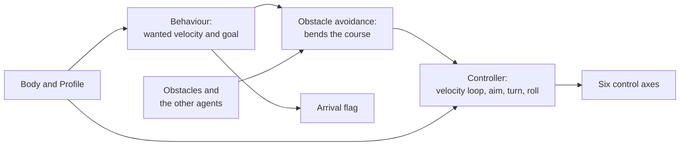

## Behaviours

A `Behaviour` says what an agent does, and gives a wanted velocity plus a `Goal`: the point it wants to be at now. Avoidance and the arrival flag read that goal. Bodies inside a behaviour (a target, a leader, a centre) are snapshots; the caller sets the behaviour again before each step for a target that moves.

**Arrive.** The wanted velocity points at the goal. Its speed is `min(max_speed, stopping_speed(distance))`: the speed from which the agent can brake to rest within the distance. The braking model is the damped double integrator against its own motion, `dv/dt = −a_b − k·v`, with `k` the profile's linear drag and `a_b = BRAKING_THRUST_SHARE · accel_forward` (0.1). Braking from `v` covers `d(v) = v/k − (a_b/k²) · ln(1 + k·v/a_b)`, and `stopping_speed` is its inverse, found by Halley iteration from a start on the high side (a series replaces `x − ln(1 + x)` for small `x`, where the difference of the two terms loses its digits). A closed form exists through the Lambert W function, but it loses its digits near the stop and needs a dependency for one scalar function. Without thrust the model is drag alone (`distance · k`), and without drag it is `√(2·a_b·distance)`.

Only a share of the thrust is planned on, because the velocity loop lags the wanted velocity: planning on all of it leaves no room to catch up, and the agent overshoots its stop. Drag alone (`distance · k`) plans on none, and starts braking about three times too early at top speed. The curve's slope is unbounded at the stop, which a loop of finite gain can't follow, so close to the goal the speed is also capped at `tail_gain · distance`. The gain is `(VELOCITY_GAIN + k) / 4`, that of a position loop around the velocity loop that is critically damped, and never below `k`, so the speed is never below what drag alone stops from.

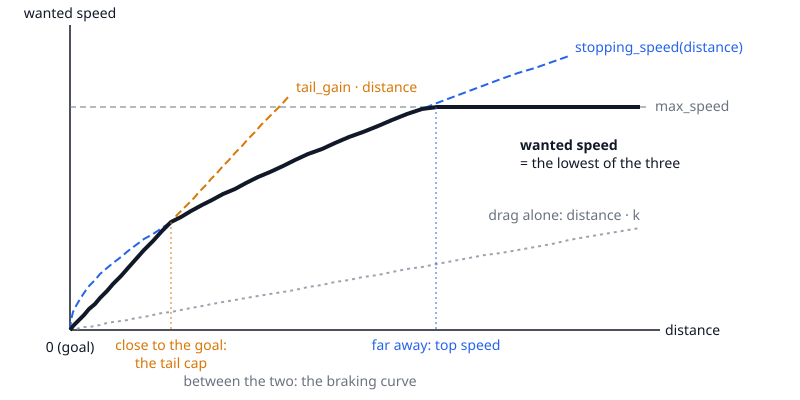

**Moving points.** Every behaviour that follows a point uses one rule: the wanted velocity is the point's velocity plus a closing speed along the line of sight, which keeps the bearing to the point constant (parallel navigation). The closing speed is `min(stopping_speed(distance), c_max)`, where `c_max` is the largest speed that keeps the total within `max_speed`. This leads a crossing target without predicting its path, and an agent that is slower than its target flies the line of sight at top speed. For a point at rest it is exactly Arrive.

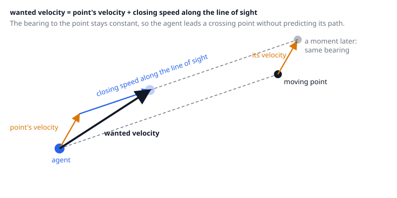

**Seek** flies at top speed toward a point and doesn't brake.

**Pursue** aims at the point `stand_off` beyond the target's hull and the agent's own along the line of sight, so it settles beside the target at the target's velocity.

**Follow** holds a slot, an offset in the leader's frame (`FrameOffset`: right, up, forward), moving with the leader.

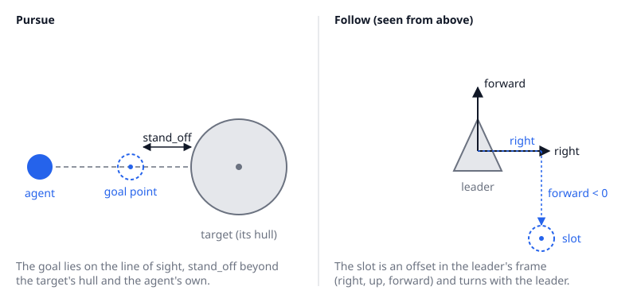

**Hold** is Arrive at the body's own position (`Behaviour::hold`).

**Orbit** flies a circle of a given radius around a centre, in the plane normal to `normal`, anticlockwise about it. In the plane the direction is the guidance vector field `normalize(tangent − gain · e · radial)` with `e = (|p|² − r²) / r²` and `gain` `ORBIT_FIELD_GAIN`: tangent on the circle and turning inward from outside and outward from inside. Out of the plane a climb term `clamp(−height · k, ±s)` pulls the agent back to the plane. The circle speed `s` solves `s⁴ / r² + k² s² = (share · a)²`: the centripetal demand and the drag together use `ORBIT_THRUST_SHARE` of the forward thrust `a`, and `s` is capped at top speed, so a ship on the circle keeps thrust in reserve for avoidance. The centre's velocity is added, so a moving centre is followed. A zero normal or a non-positive radius makes the agent match the centre's velocity.

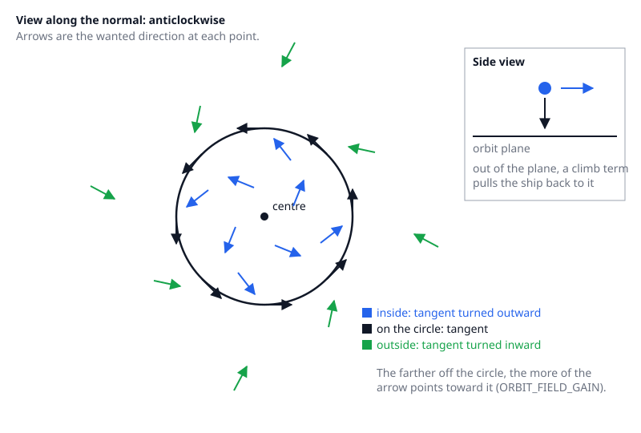

An agent has arrived when its centre is within the goal's arrival radius, held to at least `MIN_ARRIVAL_RADII` (2) of the agent's own radii (`Goal::effective_arrival_radius`). A smaller circle can't be honoured by a crowd: goals closer together than the hulls make the agents dodge each other around the goals without any of them reaching its circle, so none arrives. The flag is positional: the agent keeps steering to stop on the goal.

A goal inside the hull of an agent that has settled can't be reached by its own agent: goals closer together than the hulls, converged on one by one, end up under the hulls of those that came first. An agent counts as arrived when its goal is held, that is, it lies within the two hulls' reach of an agent that arrived at the step before and is at rest (below `AT_REST_RADII_PER_S` of its radii per second), and the agent is within `HELD_GOAL_GAP_RADII` (3) of its own radii of that agent's hull. The agent that holds the goal is not asked to move.

## Obstacle avoidance

Obstacles are spheres with a velocity, assumed constant. Every other agent is one too: a sphere at its position with its bounding radius and its current velocity, whatever its goal (an agent that has arrived or has no goal is a resting sphere). An agent never avoids itself. For each obstacle, the agent's wanted velocity is taken relative to the obstacle, and the time when the agent first comes within the obstacle's *reach* is solved exactly (a quadratic). The reach is the obstacle's radius plus the agent's radius plus a *clearance*. The clearance is the distance the agent takes to brake to rest from the speed it currently closes on that obstacle at (`stopping_distance(closing speed)` on the curve of Arrive, from the agent's body velocity, not the wanted one), clamped between `MIN_CLEARANCE_RADII` (0.5) and `clearance_radii` agent radii. A slow agent therefore fits through gaps that a fast one has to avoid. The clearance is computed from the state at the start of the step, never from the course being tested, so the threat test doesn't change with the course it judges. It is also capped so that the goal's arrival circle (the effective arrival radius) lies outside the reach, down to 0 (the hull itself): a goal next to a sphere, such as the berth beside a ship that has arrived, can still be approached. Obstacles never reached within `horizon_s` are ignored. When none is reached, the wanted velocity is kept.

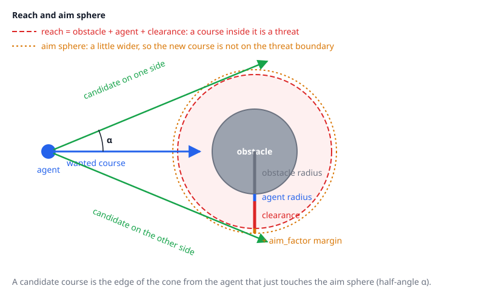

**Reciprocity.** Agents of one world avoid each other reciprocally, after the reciprocal velocity obstacle of van den Berg, Lin and Manocha, "Reciprocal Velocity Obstacles for Real-Time Multi-Agent Navigation" (ICRA 2008, doi 10.1109/ROBOT.2008.4543489). The threat test is a velocity-obstacle test in the other sphere's frame, so the rule is a changed sphere velocity. An agent takes a *share* of the avoidance against each agent sphere: ½ when that agent is steering (it has a behaviour), otherwise 1. Bodies sensed from physics and agents without a behaviour keep the share 1. With a share of ½, the courses are tested against a sphere that moves at the mean of the two agents' velocities, so each agent takes half of the detour, and the closing-speed limit plans the braking on half of the room to the hull, since the other agent brakes the other half. The clearance keeps using the true closing speed from the true velocities. A head-on pair at equal speed turns about half as far each, and a crowd dodges for less time than with the full share.

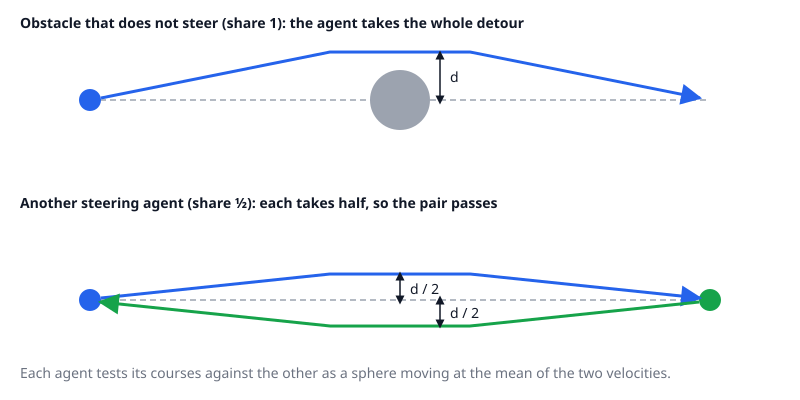

**Tracked target.** The body a Pursue or Follow agent tracks is left out of that agent's scene, whether it is an agent of the same world or a sensed body: a follower doesn't swerve from its leader when the leader brakes or the slot lies behind it. The leader leaves its tracker out of its scene too while the tracker is behind it, that is, while the tracker's centre is behind the plane through the leader's centre normal to the leader's wanted course. The tracker is then the one that keeps the distance: the leader's braking would close on a follower that flies at its speed, so avoiding it would forbid the braking, at any share, and the leader would overshoot its goal. A tracker ahead of or abreast of the leader is avoided with the half share of any steering agent, so a follower on the leader's course ahead is still dodged. A tracker near the plane can switch between the two as the leader's course swings. Orbit keeps its centre in the scene, so an orbit that passes through it is bent.

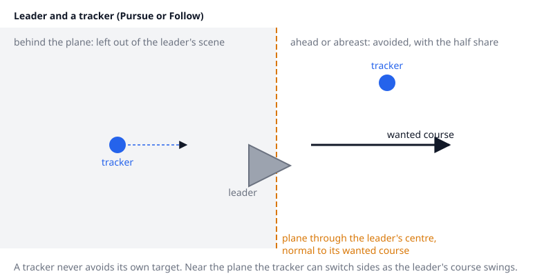

Each course is tested against every sphere, so a step computes what the tests need of a sphere (offset, distance, reach, aim radius, clearance) once per agent and sphere, and the tests read it. A sphere that no course within the agent's speed bound (its top speed, or its wanted or current speed when larger) can come within reach of inside the horizon is skipped by the course search. Such a sphere can't be a threat, so skipping it never changes the result. The closing-speed limit still looks at every sphere with the limited course itself, which can be faster than the bound.

Otherwise the course is bent around the threat. A *candidate course* passes one obstacle along the edge of the cone from the agent that just touches the aim sphere (half-angle `α`, `sin α = aim radius / distance`). The aim radius is the obstacle's radius plus the agent's radius plus `aim_factor` times the clearance (not times the whole reach, which would put the aim sphere far past the surface of a big rock). The relative speed is kept, the obstacle's velocity is added back, and the speed is capped at the profile's maximum. `aim_factor` is a little above 1, so the new course isn't on the boundary the threat test uses, and the avoidance doesn't switch on and off every step.

Each threatening obstacle gives two candidates, one on the side the course already leans to and one on the other side. Every candidate is tested against all obstacles with the same threat test. An obstacle that blocks a candidate and has not been expanded yet adds its own two candidates, breadth first, up to `MAX_EXPANDED_THREATS` (4) obstacles per agent and step, so the cost stays a few candidates times the number of obstacles instead of growing with their square. The search stops at the first level that has a clear candidate. When the agent has a side memory (see below), it stops only at a clear candidate on the kept side, and otherwise searches on while obstacles remain to expand. The agent takes:

- the clear candidate that passes the first sphere on the side the agent passed it on at the previous step, if there is one (the *side memory*; see below); otherwise
- the clear candidate with the smallest turn from the wanted direction; or
- when none is clear, the candidate (the wanted course included) whose first contact comes latest.

The side memory is the sphere's index and the direction, across the line to its centre, that the course leaned to. While the same sphere is the first one reached, the candidate on that side is taken whenever it is clear, even if the other side turns less. Without it, the side flips as the agent's position and velocity shift, and an agent whose nose follows the course never builds speed. The memory is replaced at every step that has a threat and dropped when the course has no side (it runs at the centre). A candidate on the kept side that a farther obstacle blocks is expanded around that obstacle, passing it on the side the course leans to, before a clear candidate on the other side is accepted: a kept side that a nearby obstacle blocks by a few metres would otherwise flip the side, and an agent that flips between two obstacles slides sideways without getting through. The kept side is given up only when no candidate on it is clear within the expanded obstacles.

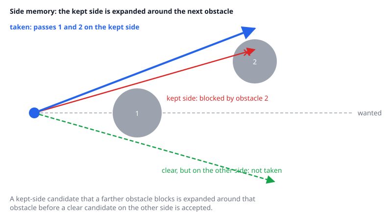

The speed the chosen course *closes* on a sphere at is also limited, for every sphere that the wanted course, the chosen course or the agent's own velocity leads into. The limit is `stopping_speed` of the distance to the sphere's hull (its surface plus the agent's radius) less a *braking margin*, the speed from which the agent brakes to rest short of the hull, the same rule as in Arrive. The margin is the distance the agent covers in `BRAKING_REACTION_S` (0.3 s) at its current speed, and at least the smallest clearance. A fast agent turns slowly, because its real velocity lags the wanted one, and a course that flips near a sphere needs room to turn: without the margin the agent reaches the sphere before its nose and velocity have followed. Only the component toward the sphere is limited; the speed along it is kept, so an agent passing a sphere isn't slowed for it. (Capping the whole speed instead makes agents crawl and dither beside every rock.)

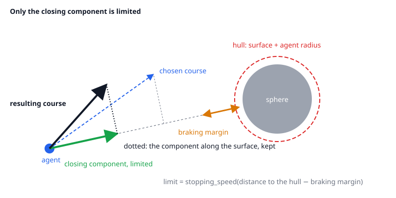

Special cases:

- An agent already inside a reach slides out along that sphere toward its goal, with an outward component that grows with the depth, so it leaves the reach instead of circling in it.
- A course through the centre has no side. A fixed rule picks one from the direction to the centre, so two agents meeting head-on choose the same side, which makes them pass each other rather than mirror each other.

Seek, pursuit and offset pursuit (Follow) follow Reynolds' steering behaviours (see below), with the lead taken from constant bearing instead of a predicted position. The Orbit field is from García de Marina and Hattenberger, "Guidance Vector Fields for Robot Navigation along Orbits" (IMAV 2017, arXiv 1709.01110); its out-of-plane term is ours.

The method is adapted from the obstacle avoidance of Reynolds, "Steering Behaviors For Autonomous Characters" (Game Developers Conference, 1999): the agent predicts which obstacle it would hit and steers around it. Here the contact time with a moving sphere is solved exactly, and the new course is the tangent to the inflated sphere, instead of a probe cylinder ahead of the agent and a lateral force.

## Controller

The controller maps the wanted velocity and the direction of travel to axes with a model of the ship: a damped double integrator, `dv/dt = a − k·v`, with thrust limited per axis. The agent's `Profile` gives the model's constants: the linear and angular drag, the acceleration at full input along the ship's forward, right and up axes, and the angular acceleration at full input about its right (pitch), up (yaw) and forward (roll) axes. A limit of 0 means no authority on that axis.

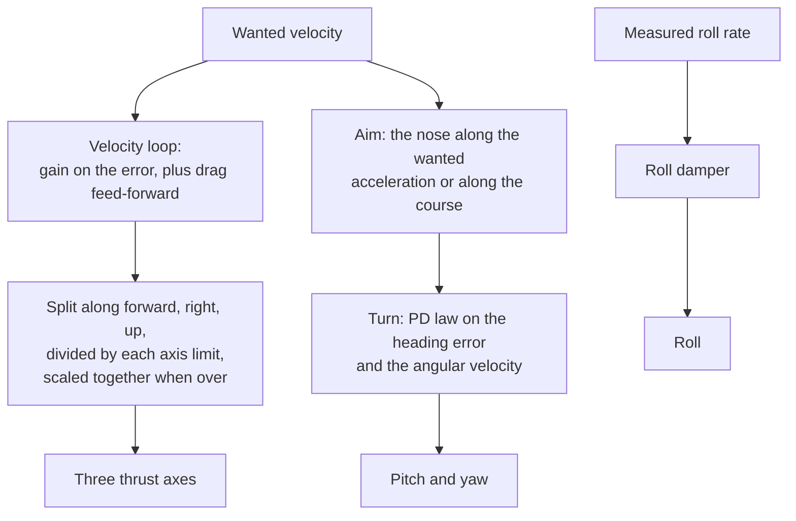

- **Velocity loop.** The wanted acceleration is `VELOCITY_GAIN · (wanted velocity − velocity)` (10 per second) plus `k · wanted velocity`, the thrust that holds the wanted velocity against drag. It is split along the ship's axes, and each part is divided by that axis's limit. When an axis exceeds its limit, all three inputs are scaled down together, so the ship still accelerates in the wanted direction. Forward and reverse thrust follow the sign of the projection, so there is no angular cut-off.
- **Aim.** The nose points along the wanted acceleration while that speeds the agent up toward its course and exceeds what the side thrusters give, so the main engine does the work. Otherwise it points along the course, and strafing and braking do the rest. Inside the goal's arrival radius the behaviour gives a rest facing instead of the course, so the nose doesn't chase a bearing that swings when the point is metres away: Follow faces the leader's heading, Arrive (and Hold) keeps the agent's own heading, Pursue faces the target's direction of motion when the target moves faster than one of its radii per second and keeps its own heading otherwise. Seek and Orbit give none. The facing turns the nose only; thrust still follows the wanted velocity, and an agent exactly on its point, with no course, still turns to its facing.
- **Turn.** Pitch and yaw are a PD law on the heading error and the measured angular velocity, in units of the axis's angular acceleration. The stiffness gives the full limit at `TURN_SATURATION_ANGLE` (0.5 rad), capped at a natural frequency of `MAX_TURN_FREQUENCY` (10 rad/s). The damping makes the loop critically damped with the angular drag counted, and is 0 when drag alone damps more. A reversed course turns about the right axis.
- **Roll.** A rate damper: the roll axis opposes the measured roll rate, at full input from `ROLL_RATE_SPAN` (1 rad/s). No behaviour supplies an up direction, so roll isn't steered to one.

## Tuning

`BRAKING_THRUST_SHARE` (0.1) is the share of the forward thrust that braking is planned on, in Arrive, the moving points and avoidance. A larger share brakes later and arrives sooner on a long leg, with diminishing gain, and costs overshoot and contacts; a smaller one approaches drag alone. The tail gain and `HELD_GOAL_GAP_RADII` are constants of `braking.rs` and `world.rs`.

Capping the speed of a detour (not only its closing component) to the stopping speed of the gap to the sphere's reach was tried: it raised the arrival rate of a crowd but halved the throughput of a dense scene and deadlocked agents in front of gaps, so only the closing component is limited.

`AvoidanceTuning` holds `horizon_s` (10 s), `clearance_radii` (2) and `aim_factor` (1.05). `clearance_radii` is the upper clamp of the speed-dependent clearance; the lower clamp (`MIN_CLEARANCE_RADII`) and `BRAKING_REACTION_S` are constants of `avoidance.rs`, and the controller's gains are constants in `controller.rs`. A longer horizon starts a detour earlier and costs more steering; a larger clearance keeps more distance from fast approaches. A larger `aim_factor` passes obstacles wider, but a goal that lies between the reach and the aim radius of a sphere can't be approached: the tangent misses it, and the agent circles outside. The goal clamp on the clearance (see Obstacle avoidance) covers goals that lie inside the reach, not those between the reach and the aim radius. A longer braking reaction trades contacts for deadlocks: agents stop in front of more gaps. In a dense scene no value of it gives neither.

## Limits

- Obstacles are spheres only, with constant velocity; the agent's own thrust limits aren't part of the avoidance. A course is judged on the wanted velocity, but a fast agent's real velocity lags it. The clearance and the braking margin cover this only as far as the braking curve stops the agent, and the curve plans on a tenth of the thrust: a larger share lets the closing-speed limit close on a sphere faster than a detour can turn, and raised the contacts in the dense scenes.
- The nose follows the aim direction at the turn gear's rate, and the wanted velocity can change faster than that. A course that flips by 100–170° within a few hundred metres of a large sphere at cruise speeds of kilometres per second can still graze it, so a dense scene with a large moving sphere sees occasional contacts. The side memory reduces such flips but doesn't remove them.
- Other agents are spheres that keep their velocity; reciprocity only halves the detour against an agent that has a behaviour, and assumes that agent can do its half. An agent pinned by thrust limits or rocks can't, and a caller that stops applying an agent's axes should clear its behaviour, or the others keep dodging only half. A leader doesn't dodge a follower behind it, so a follower that can't brake (pinned by thrust limits or rocks) isn't avoided by its leader and can touch it. Agents whose goals are closer than their hulls plus clearances (berths a hull apart) can't all hold them: the clearance clamp lets them approach, and the arrival radius floor lets them arrive at the edge of the crowd instead of dodging in front of the berths. A crowd that arrives together still dodges for longer than a lone agent.
- The closing-speed limit makes an agent stop in front of a gap that its clearance makes impassable, instead of squeezing through it: it waits there until the goal or the obstacles move.
- The two candidates of an obstacle lie in the plane of the relative velocity and the direction to the centre. A pocket that only opens out of that plane, or more than `MAX_EXPANDED_THREATS` obstacles in a row, can be missed; the agent then takes the latest contact.
- An orbit that passes inside an obstacle's reach is pushed off its circle by avoidance, and goes back to it once clear. Ships on one orbit aren't spaced out along it.
- Goals closer to an obstacle than `aim_factor` times its reach are hard to approach (see Tuning).
- Sensed bodies are read as of the last `Physics::update`: the query index is refreshed there, so a body that moved or was added since is seen at its old place until the next update. A body is found when one of its colliders is within the range, so a compound may be found by a part that is far from its centre.
- The cost of a step grows with agents × obstacles (agents are obstacles too); there is no spatial index. The reachability skip rejects spheres only beyond what a course covers within the horizon (88 km for a 8.8 km/s ship and the default horizon), so it saves little at the scale of one system's local space.

## Engine wrapper (`NavWorld`)

`NavWorld` (`engine/lib/phx/src/nav/`) is the Lua handle on a `World`. It is created for one `Physics` (`NavWorld.Create(physics)`) and reads its bodies from that physics world, so Lua pushes no body state.

- **Registration.** `addAgent(body, linearDrag, angularDrag, thrustForward, thrustRight, thrustUp, torquePitch, torqueYaw, torqueRoll)` returns the agent's id (a `u32`: 0, then consecutive). The drags are per second; the thrusts and torques are the forces and torques the ship applies along and about its own axes at full input. `NavWorld` reads the body's mass and principal inertia from physics at every step and turns them into the accelerations of the `Profile`, so a change of mass reaches the controller; the top speed is the forward acceleration over the linear drag. An agent's body must be a root body added to that physics world. There is no removal: it has to stay in the physics world, and `step` panics, naming the agent, if it has left. Obstacles are not registered: sensing (below) finds them.
- **Behaviours and tuning.** One behaviour per agent, replaced by the next setter; `clearBehaviour(id)` leaves the agent without input. Lengths are in game units, and every arrival radius is floored at two of the agent's radii (see Arrive).
  - Fixed points, as a `Position` in world coordinates: `setArrive(id, target, arrivalRadius)` stops there, `setSeek(id, target, arrivalRadius)` flies through at top speed without braking, and `setHold(id, arrivalRadius)` keeps the body's position at the call.
  - Moving targets, given as a `RigidBody`: `setPursue(id, body, standOff, arrivalRadius)` meets it `standOff` from its hull, `setFollow(id, body, right, up, forward, arrivalRadius)` holds a slot in its axes, and `setOrbit(id, body, radius, normal, arrivalRadius)` circles it anticlockwise about `normal`, which must be finite and not zero. The target must be a root body of the agent's physics world; its state is read at every `step`, so it can move, and `step` panics, naming the agent, if it has left the physics world. `setPursue` and `setFollow` leave the target out of the agent's avoidance (it is looked up as the agent with that body, else as the sensed body); `setOrbit` keeps its centre in it, and every other setter and `clearBehaviour` clear the exclusion.

  `setAvoidanceTuning(horizonS, clearanceRadii, aimFactor)` replaces the tuning (defaults as in `AvoidanceTuning`).
- **Sensing.** `setSensing(mask)` with a non-zero mask makes each `step` run one ball query on the physics world's query index per agent, at the agent's sensing range (`nav::sensing_range`: the distance a course can reach inside the avoidance horizon, the same range the reachability skip uses), and keep the bodies with a collider in the ball whose collision group shares a bit with `mask`. Agents whose balls overlap share one query, an enclosing ball no more than `MAX_QUERY_GROWTH` (1.5) times the larger radius, so a crowd costs a few queries and not one per agent; the extra bodies it finds are dropped by the reachability skip. The bodies found for all agents form one scene, listed by key; each is a sphere (position, velocity, the radius of the sphere covering all of the body's colliders), and the reachability skip leaves out the ones an agent can't reach. Agents, their own parts and triggers are never sensed, so nothing is counted twice. A body's key comes from its Rapier handle, so an agent's side memory (`Commitment`) holds across steps while bodies enter and leave the range, and a body that leaves physics is simply no longer found. Sensing is off by default (`setSensing(0)`), and then agents steer around nothing.
- **Step.** `step()` reads each agent's and tracked body's position, velocity, angular velocity, mass, inertia, rotation and the bounding radius of its collider, turns the rotation into a frame (forward is -z, right +x and up +y in the body's axes, as `Quat` does), and runs `World::step`. All values are in game units and seconds.
- **Results.** `copyAxes(buffer, length)` fills a `double[?]` with `AxisCount()` values per agent, in agent order and in the order of the `NavAxis` enum (`Pitch`, `Yaw`, `Roll`, `ThrustForward`, `ThrustRight`, `ThrustUp`); `copyArrived(buffer, length)` fills a `bool[?]` with one flag per agent. A buffer of the wrong length panics.

## Tests and benchmarks

Unit tests sit with the modules. `tests/flight.rs` flies agents through a model of a ship (drag, per-axis thrust limits, angular acceleration from torque with angular drag) past static and moving spheres, and checks they arrive and keep clear. It checks that behaviour, avoidance and controller work together, not the real ship's response.

`NavWorld`'s tests (in `phx`) use real rigid bodies in a `Physics`: they check that a step follows the body in physics, that obstacle bodies change the axes, that a pursued rock or a followed agent is left out of the scene and an orbit's centre is not, that a later behaviour avoids the body again, and that bad registrations, ids, buffers and removed bodies panic.

`cargo bench -p nav --bench step` measures one step for 100 agents and 60 obstacles in two scenes: a sparse one spread over a large cube, where the avoidance rarely triggers, and a dense one where every agent flies through a field of obstacles on its course, so the candidate search runs at almost every step.
