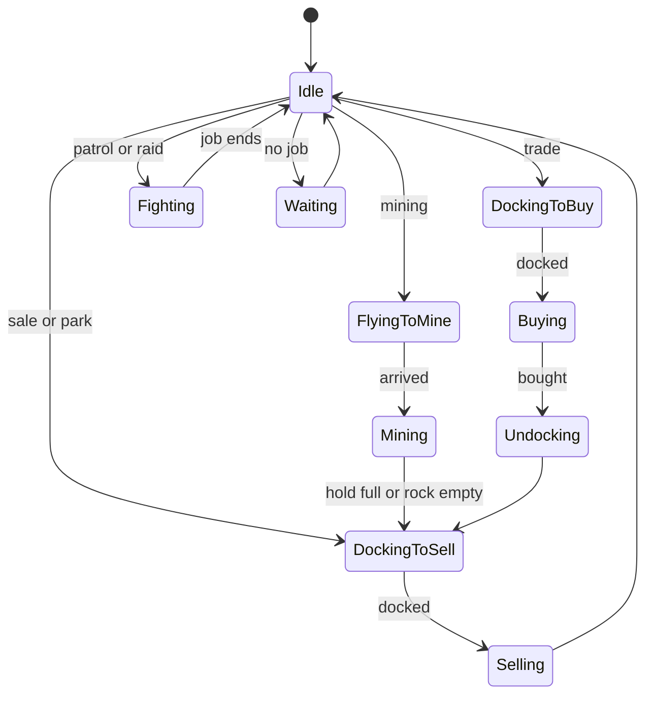

# Economy

The economy is the `Economy` module (`script/Modules/Economy`): markets at stations, production at
stations, regrowing yields on asteroids, and AI ships that trade and mine. Ships fly with
[navigation orders](nav/navigation.md) and dock with [docking](docking.md). Everything runs on the
simulated clock: the systems subscribe to `PreSim`, whose time stops while the game is paused and
speeds up with the time acceleration.

`EconomyDemo` (`script/States/App/EconomyDemo.lua`) runs it to watch; `Tests/Economy/EconomyDemoTest`
runs the demo and checks its work; `Tests/Economy/MarketplaceTest` stresses one market with random
orders and prints its price development.

## The parts

| Part | Where | What it does |
|---|---|---|
| `MarketplaceComponent` | a station | Open bids and asks (order entities) and the price state of each item: trade history, emergent price, shifting equilibrium, pull timeout, conditions. |
| `InventoryComponent` | a station, a ship | Item stacks by item id, with an optional mass capacity. Changed through `InventoryManager`. |
| `PlayerBankAccount` | a station, a ship, a player | Credits. `AccountManager:accountOf(entity)` is the entity's own account, or its `Ownership` owner's. |
| `ProductionComponent` | a station | Production lines, each running a recipe of `Shared/Definitions/RecipeDefs.lua`. |
| `MarketMakerComponent` | a station | Makes the station keep bids for its recipes' inputs and asks for their outputs. |
| `YieldComponent` | an asteroid | A deposit that regrows: its `QuantityComponent` is what is left. |
| `EconomyAgentComponent` | a ship | A trader or a miner, its job and its state. |

`EconomySetup` gives entities their part: `equipStation(station, definition, name)` with a definition
of `Shared/Definitions/StationEconomyDefs.lua`, `equipAsteroid(asteroid, item, quantity, regrow)`,
and `equipAgent(ship, { role, capacity, credits | owner, name })`.

## Markets

`MarketplaceSystem` matches each market's orders every one to three seconds and settles the trades.

- **Escrow.** `postAsk` takes the goods out of the issuer's inventory; `postBid` takes quantity times
  price out of its account. An order that is cancelled (`cancelOrder`, `cancelOrdersOf`), expires or
  whose issuer is gone gives back what is left.
- **Matching.** Per item, the highest bids meet the lowest asks while the bid is at least the ask. A
  trade is at the middle of the two prices: the seller gets it, the buyer gets the goods and the
  difference to its bid back. Orders of one issuer don't trade with each other; contraband orders
  don't trade on a market.
- **At once.** `buyNow` and `sellNow` post an order and match it in the same call, then take back
  what didn't fill: what a docked ship uses.
- **Prices.** Each trade enters the market's history; the market price is then recomputed from the
  book and the history (the original emergent price model): a base price (the history once it holds
  `priceDiscoveryPeriod` trades, else the best prices), moved by the ratio of demand to supply, pulled
  toward the item's start price and the market's shifting equilibrium, clamped to a band around the
  history, with noise that lessens as the market matures. A trade far from the shifting equilibrium
  starts a pull timeout, during which the pull is off. `getSuggestedBidPrice`/`getSuggestedAskPrice`
  and `quote(market, item, exclude)` read the state.

## Stations

`ProductionSystem` starts a line's cycle when the inventory holds the recipe's inputs and has room
for its outputs, and after the recipe's duration adds the outputs and pays the recipe's `income`, the
economy's only source of new credits (a colony's earnings). A line idles while the station already
holds `stockCapCycles` cycles' worth of every output (its asks on its own market included), so a
plant nobody buys from stops piling up stock. It also regrows yields.

`MarketMakerSystem` reposts a station's orders every few seconds: it takes them back (their escrow
returns), then bids for each input up to a stock target and asks for all it holds of each output.
The target is what the lines consume or make over `stockCycles` cycles; an input's target also
covers what the lines consume over `resupplyS` seconds, since a miner or hauler takes minutes to
bring it and brings only what is bid for. A price is the market's
shifting equilibrium for the item, bounded to a range around the start price, times a factor: a bid
pays more the emptier the stock is, an ask asks more the less the station has. The equilibrium only
follows trades, so prices find their level through what is traded without running away on the
station's own quotes. A station that can't pay for every bid scales them down alike.

## Agents

An agent (`EconomyAgentComponent`) has no fixed role. Its ship's equipment decides the jobs it can do,
and each time it is free `EconomyAgentSystem` chooses the best of them by profit per second:

| Job | Needs | Pays |
|---|---|---|
| Sale | cargo | what the best-paying station within reach bids for it |
| Trade | a hold | the margin between a station's ask and another's bid |
| Mining | a mining laser | the bid for the ore at a station |
| Patrol | weapons | what the threatened station pays (see [factions](factions.md)) |
| Raid | weapons, a marauder faction | what the fence pays for the loot |

- **The job board.** `JobBoardSystem` gathers the system's work every `refreshS` seconds: trade
  routes, mining runs, the bids an agent with cargo can sell to, and security jobs at threatened
  stations. An agent weighs the most profitable of them for itself (its place, hold and credits),
  timed with `Nav.estimate`, and doesn't deal at stations of factions hostile to its own.
- **Claims.** A job holds the quantities it plans to buy, sell and mine, and its patrol slot, against
  the other agents' plans at once, so agents planning in the same update don't take one lot; at most
  `maxMinersPerAsteroid` miners work a rock. What is left is the board's unfilled work, which the
  spawner buys ships for.
- **Flights.** Docking legs use `DockingSystem:requestDock`; a ship docked elsewhere undocks first. A
  miner flies a `MoveTo` with a stand-off of `mineGapM` from the rock and hands over to
  `MiningSystem`; a fighting job hands the ship to `CombatAgentSystem` for its length. A leg that
  hasn't ended after `maxLegS` is given up with its job; a ship with nothing to do docks at the
  nearest station to wait, and keeps looking for work on the way.
- **Trades** happen docked, after `serviceS`, at once, within `priceSlack` of the planned price.
  What didn't sell is sold by the next job. Earnings are kept per kind of job.

## Mining

`MiningSystem` runs a miner's run at its rock (`MiningComponent` on the ship, from `begin` to
`finish`):

- The ship's controls are claimed and its body made kinematic. It glides onto a circle just off the
  rock's surface (`clearance`), at the latitude of the deposit's main ore spot, and flies round it at
  `circleSpeed` with its nose on the rock.
- A deposit (`YieldComponent`) has ore spots: directions in the rock's own axes. The laser (a beam that
  does no damage, `MiningLaserDefs`) plays on the spot that faces the ship most, and ore is taken only
  while it does, at `rate` units a second.
- The run ends when the hold is full, its quantity is taken, the rock is empty or gone, or time is up;
  the body and controls go back to the ship's orders. A run that took nothing makes the miner leave
  that rock alone for `badRockS`.

`MiningEffectsSystem` shows it: the laser flickers; sparks flash at the spot; chips of ore break off
it and drift into the miner; a deposit's rock shrinks to `minRockScale` of its size as it is mined
out, grows back as it regrows, and tumbles slowly.

`Testbeds/Mining` is a light scene to watch it in: an ore field, a refinery and three miners, no
player ship, the orbit camera on the miner that starts mining first (Left and Right pick another).
The laser fires in pulses round its spot until its capacitor is empty, then recharges while the ship
circles and moves on to the spot that faces it.
