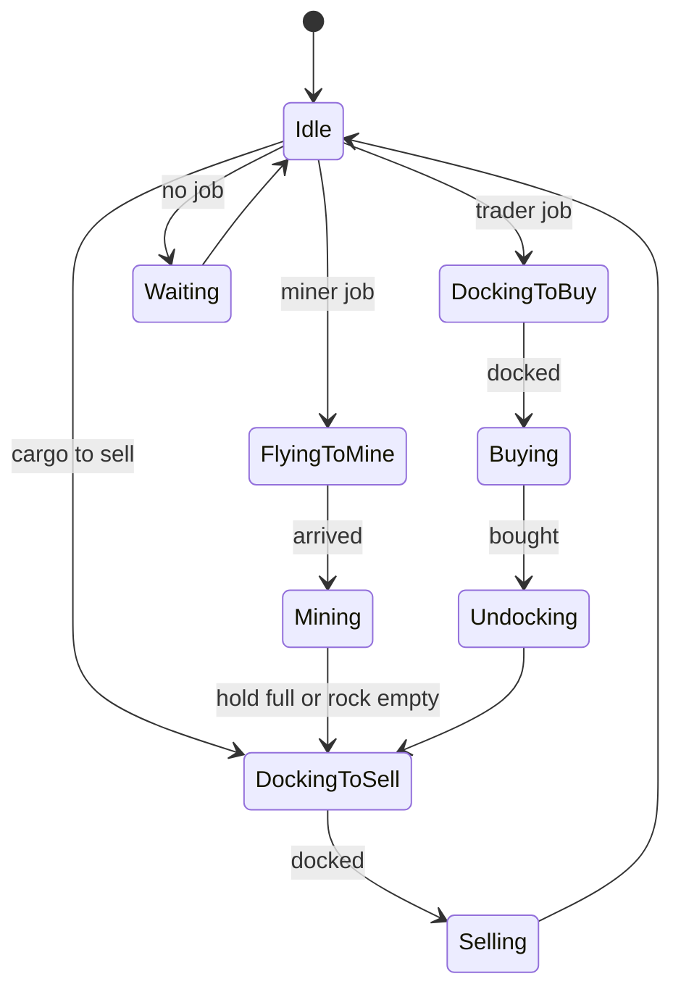

# Economy

The economy is the `Economy` module (`script/Modules/Economy`): markets at stations, production at
stations, regrowing yields on asteroids, and AI ships that trade and mine. Ships fly with
[navigation orders](nav/navigation.md) and dock with [docking](docking.md). Everything runs on the
simulated clock: the systems subscribe to `PreSim`, whose time stops while the game is paused and
speeds up with the time acceleration.

`EconomyDemo` (`script/States/App/EconomyDemo.lua`) runs it to watch; `Tests/Economy/EconomyDemoTest`
runs the demo and checks its work; `Tests/Economy/MarketplaceTest` stresses one market with random
orders and prints its price development.

## The parts

| Part | Where | What it does |
|---|---|---|
| `MarketplaceComponent` | a station | Open bids and asks (order entities) and the price state of each item: trade history, emergent price, shifting equilibrium, pull timeout, conditions. |
| `InventoryComponent` | a station, a ship | Item stacks by item id, with an optional mass capacity. Changed through `InventoryManager`. |
| `PlayerBankAccount` | a station, a ship, a player | Credits. `AccountManager:accountOf(entity)` is the entity's own account, or its `Ownership` owner's. |
| `ProductionComponent` | a station | Production lines, each running a recipe of `Shared/Definitions/RecipeDefs.lua`. |
| `MarketMakerComponent` | a station | Makes the station keep bids for its recipes' inputs and asks for their outputs. |
| `YieldComponent` | an asteroid | A deposit that regrows: its `QuantityComponent` is what is left. |
| `EconomyAgentComponent` | a ship | A trader or a miner, its job and its state. |

`EconomySetup` gives entities their part: `equipStation(station, definition, name)` with a definition
of `Shared/Definitions/StationEconomyDefs.lua`, `equipAsteroid(asteroid, item, quantity, regrow)`,
and `equipAgent(ship, { role, capacity, credits | owner, name })`.

## Markets

`MarketplaceSystem` matches each market's orders every one to three seconds and settles the trades.

- **Escrow.** `postAsk` takes the goods out of the issuer's inventory; `postBid` takes quantity times
  price out of its account. An order that is cancelled (`cancelOrder`, `cancelOrdersOf`), expires or
  whose issuer is gone gives back what is left.
- **Matching.** Per item, the highest bids meet the lowest asks while the bid is at least the ask. A
  trade is at the middle of the two prices: the seller gets it, the buyer gets the goods and the
  difference to its bid back. Orders of one issuer don't trade with each other; contraband orders
  don't trade on a market.
- **At once.** `buyNow` and `sellNow` post an order and match it in the same call, then take back
  what didn't fill: what a docked ship uses.
- **Prices.** Each trade enters the market's history; the market price is then recomputed from the
  book and the history (the original emergent price model): a base price (the history once it holds
  `priceDiscoveryPeriod` trades, else the best prices), moved by the ratio of demand to supply, pulled
  toward the item's start price and the market's shifting equilibrium, clamped to a band around the
  history, with noise that lessens as the market matures. A trade far from the shifting equilibrium
  starts a pull timeout, during which the pull is off. `getSuggestedBidPrice`/`getSuggestedAskPrice`
  and `quote(market, item, exclude)` read the state.

## Stations

`ProductionSystem` starts a line's cycle when the inventory holds the recipe's inputs and has room
for its outputs, and after the recipe's duration adds the outputs and pays the recipe's `income`, the
economy's only source of new credits (a colony's earnings). It also regrows yields.

`MarketMakerSystem` reposts a station's orders every few seconds: it takes them back (their escrow
returns), then bids for each input up to a stock target and asks for all it holds of each output.
The target is what the lines consume or make over `stockCycles` cycles. A price is the market's
shifting equilibrium for the item, bounded to a range around the start price, times a factor: a bid
pays more the emptier the stock is, an ask asks more the less the station has. The equilibrium only
follows trades, so prices find their level through what is traded without running away on the
station's own quotes. A station that can't pay for every bid scales them down alike.

## Agents

`EconomyAgentSystem` runs each agent as a state machine:

- **Jobs.** A ship with cargo first sells it at the station that bids best for it per second of
  flight. Else a trader looks for an item a station asks less for than another bids, and a miner for
  an asteroid whose item a station bids for. Quantities are limited by the hold, the credits, the
  offer and the demand. The most profitable candidates are timed with `Nav.estimate` (with a docking
  overhead), and the best by profit per second is taken.
- **Claims.** A job holds the quantities it plans to buy, sell and mine against the other agents'
  plans, and at most `maxMinersPerAsteroid` miners work a rock.
- **Flights.** Docking legs use `DockingSystem:requestDock`; a ship docked elsewhere undocks first. A
  miner flies a `MoveTo` with a stand-off of `mineGapM` from the rock, then holds there facing it,
  taking `miningRate` units a second.
- **Trades** happen docked, after `serviceS`, at once, within `priceSlack` of the planned price.
  What didn't sell is sold by the next job.
