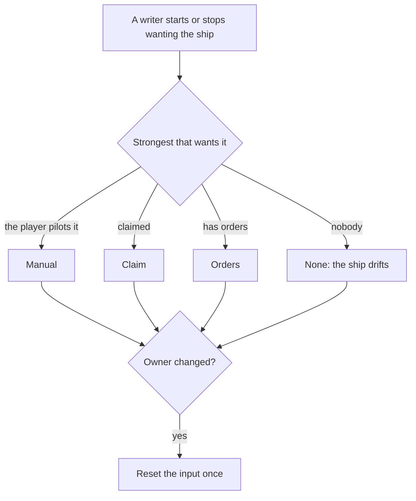
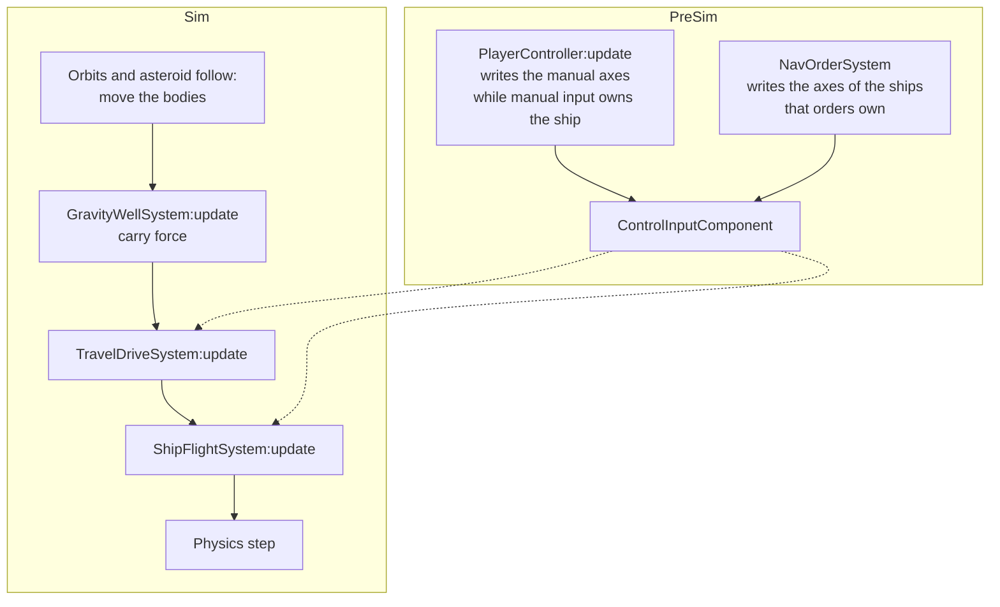
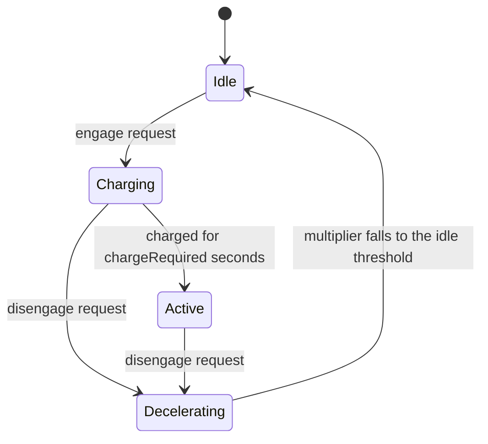

# Ship flight control

Every ship flies from one data path: whoever steers it writes a `ControlInputComponent` on the ship, and the actuation systems turn that component into forces. The player, an autopilot and AI are all writers; no actuation system reads an input device.

## Control input

`ControlInputComponent` (`script/Modules/Constructs/Components/`) holds:

| Field | Range | Meaning |
|---|---|---|
| `thrustForward`, `thrustRight`, `thrustUp` | `ControlAxis`, [-1, 1] | Fraction of the ship's profile thrust along its axes |
| `pitch`, `yaw`, `roll` | `ControlAxis`, [-1, 1] | Fraction of the ship's profile torque about its axes |
| `boost` | [0, 1] | Forward thrust is multiplied by `1 + 2·boost` |
| `driveRequest` | `Enums.TravelDriveRequest` | `Engage` or `Disengage` the travel drive; `None` when nothing is pending |
| `driveSpeedCap` | multiplier ≥ 1, or nil | Highest drive multiplier the ship asks for; nil is no cap |

Axes are levels: the writer sets them every frame (`clearAxes()` zeroes them). The drive request is an edge: `TravelDriveSystem` clears it once it has applied it. A writer that has no manual input this frame clears the axes, so a ship never keeps flying on stale input.

## Control ownership

Whoever writes a ship's input must own it. `ControlOwnerSystem` decides, per ship, from what the writers want: manual input (the player's controller pilots the ship) over a claim (`Nav.claim`: an AI writes the input itself) over navigation orders. The owner is kept in a `ControlOwnerComponent` and recomputed when a writer starts or stops wanting the ship, not once per frame, because event subscribers have no order inside a stage and a per-frame decider could run after the new owner had written. When the owner changes, the input is reset once: axes zeroed, the drive's speed cap lifted, the travel drive told to disengage.

The order system writes only while it is the owner: a ship with another owner leaves the navigation world, and its begun orders are suspended ([navigation orders](nav/navigation.md#control-ownership)). The player's autopilot is an order: the controls pass from manual input to orders while it flies, and back when it ends or the player takes them.

## Flight profiles

A ship's flight limits are data, not configuration: a `FlightProfile` (`Shared/Types/FlightProfile.lua`) per ship class, registered in `FlightProfileRegistry` by an `Enums.FlightProfile` id from `Shared/Definitions/FlightProfileDefs.lua`. The ship holds its profile in a `FlightProfileComponent`; the flight systems read the limits from it and fail loudly on a ship that flies without one.

| Field | Unit | Meaning |
|---|---|---|
| `mass` | kg | Body mass |
| `linearDrag`, `angularDrag` | 1/s | Damping of velocity and spin |
| `thrustForward`, `thrustRight`, `thrustUp` | force, game units | Largest force along each ship axis; these are the effective limits, with no further gain applied |
| `torquePitch`, `torqueYaw`, `torqueRoll` | torque, game units | Largest torque about each ship axis |
| `maxSpeed` | game units/s | Speed that full forward thrust settles at |

Definitions are authored in real metres and compressed to game units once. The forward thrust is derived as `maxSpeed · mass · linearDrag`, so full thrust against the drag settles at `maxSpeed`. Boost and the steering torque during a travel drive are flight-model gains in `ShipFlightSystem`, not profile data.

A ship gets its profile by passing `flightProfile` in the config of `ShipGenerator` (and so of `ConstructManager:createShip`): the generator adds the component and applies the profile to the rigid body through `FlightProfileHelper.applyToRigidBody`. That sets the mass, the drag, no friction, no sleeping and the soft-CCD distance (one frame of travel at `maxSpeed`). Hull size stays in `Config.game.shipHulls`.

## Writers

- `PlayerController:update(dt)` reads `ShipActions` and writes the player ship's component. Chase mode steers by the cursor's position on screen, first person by cursor movement (an aim target accumulates and decays back to centre), and an active drive by cursor movement in either mode. It writes only while manual input owns the ship (not while the autopilot flies); axes are cleared while input is blocked or the camera is not a piloting one. The travel-drive key engages an idle drive and stops a running one; firing stops it.
- The flight of a MoveTo order (`PlanFlight`), which the player's autopilot is, runs as an agent of the navigation world with sensing on for every collision group, so the ship steers around the collidable bodies near it (the target body too: the stand-off point lies outside its hull). While the travel drive runs the ship has no lateral thrust and turns at a tenth of its torque, so avoidance acts only in normal flight; a body in the way of a drive flight is avoided by the plan instead. On beginning, the flight requests a path plan from the system planner (see [system planner](nav/system-planner.md#consumers)): in normal flight while it is out, then the plan's corners (the drive on its drive legs, off on arcs), then the stand-off approach below. Without a usable plan (a target that moves faster than the ship can fly before it reaches the target's gravity well has none; the well carries the ship, so a planet whose stand-off point is inside its well is planned) it flies the stand-off approach from the start, drive included, with no detours. It tracks the target (without a lead for a moving one), sets a goal on the line from the ship to the target at a stand-off distance from the target's centre, steps the `NavWorld`, and `NavOrderSystem` copies the six axes into the ship's component. The order is done when the `NavWorld` reports the goal reached; the arrival radius is a share of the gap between the stand-off distance and the target's radius, so a ship that coasts in after the order is done stays outside the hull. In the final approach it requests the drive when the target is more than 100 stand-off distances away (there is no engage delay), and sets `driveSpeedCap` from a braking law: the wanted speed is the distance to the stand-off point divided by a braking time, so the cap is `distance / (brakingTime · maxSpeed)`, limited by the zone's cap. The braking time is 4 times the sum of the drive multiplier's lag (`1 / rampDownSpeed`) and the velocity's lag (`1 / linearDrag`); at that margin the loop from distance to speed has real roots, so the ship decays onto the stand-off point without overshooting, and a margin of 2 oscillates. Below a drive multiplier of 2 the drive is released and the `NavWorld` flies the rest at normal speed. The ETA comes from the same law: a cruise at the zone's cap while the law wants more, then an exponential decay, then the flight at `maxSpeed`. Because the drive multiplier and the velocity lag the falling cap, the distance decays faster than `1 / brakingTime`; the ETA uses the rate that solves `r = 1 / (T · (1 - r·τ₁) · (1 - r·τ₂))`. The ETA uses the zone cap at the ship's position and leaves out the drive's charging and ramp-up time, so it runs short. While the corners of a plan are flown, the ETA is the plan's goal time minus the plan's age: the time the planner gives the ship to come within the arrival radius, with the charge and the ramp-up in it. The goal rides on the target's body (`setArriveRelative`), so it has the body's velocity and the ship comes to rest relative to the body, and before each step the flight gives the `NavWorld` the velocity the ship's gravity well carries it at (`NavAgentHelper.setFrameFromWell`). The ship is then steered relative to the well, so it can arrive at a planet whose orbital speed is above its top speed; the speed the flight reads for its braking is the speed relative to the well too. While the order flies, the ship's body must stay in the physics world.
- `NavOrderSystem` (Navigation module) flies the ships that have orders, at `PreSim` too: every ship with an order is an agent of one shared `NavWorld`, and the system writes each one's control input from the world's axes, with the drive requests of the flight code above (`PlanFlight`). It writes the input only of ships that orders own, that is, no ship the player pilots by hand and none an AI has claimed ([navigation orders](nav/navigation.md)).
- `AutoPilotSystem` is the player's autopilot: a MoveTo order of `Urgent` priority given to the player's ship. Engaging it (the map's Navigate key) gives the ship the order and hands the controls from manual input to orders; engaging again while it flies gives the order the new target. When the order ends (arrival, or a failure), the controls go back to the player, and the ownership reset zeroes the axes and stops the drive. Taking the controls by hand cancels the order and hands them back at once: any of the thrust, roll, boost, travel-drive or fire keys does it (the cursor does not), unless input is blocked, as it is while the map is open. Navigate again starts the flight again. `PlayerController` writes the player's input only while manual input owns the ship.

## Actuation

A frame writes control input at `PreSim` and actuates it at `Sim`. The writers (`PlayerController:update(dt)`, which writes only while manual input owns the ship, and `NavOrderSystem`, which writes the ships that orders own, the autopilot's among them) run in the app's `PreSim` handler. The app's `Sim` handler then moves the bodies (orbits, asteroid follow), applies the gravity wells' carry force (`GravityWellSystem:update(dt, substeps)`), runs `TravelDriveSystem:update(dt)`, then `ShipFlightSystem:update()`, then the physics step. The `Sim` handler calls them in this order because `EventBus:subscribe` gives no ordering inside a stage, and the bodies must have moved before the ships are actuated. Both actuation systems process every ship that has the components they need.

- `ShipFlightSystem` clamps the axes and applies forces and torques. While the travel drive is active it ignores thrust and boost, because the drive provides the forward force, and applies a tenth of the torque.
- `TravelDriveSystem` runs the drive's states: idle, charging, active, decelerating. An engage request starts charging an idle drive; after `chargeRequired` seconds the drive is active. A disengage request moves a charging or active drive to decelerating. While active, the multiplier approaches `min(zone limit, driveSpeedCap)`: upward linearly at `rampUpSpeed`, downward exponentially with time constant `1 / rampDownSpeed`. All ramps are functions of elapsed time, so the result does not depend on the frame rate.

The zone limit is `GravityWellSystem:getMaxDriveSpeedAt(position)`, evaluated at the position of each ship, so every ship has its own limit. See [Zones and gravity wells](zones.md).
