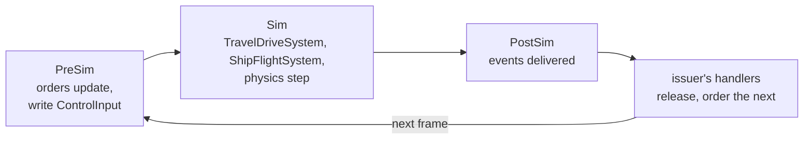

# Navigation guide

How to use navigation from game code: give ships orders, read their progress, react to their events, and shape their routes. This page is for designers, scripters and coding agents alike. The contract of every call is in [navigation orders](navigation.md); this guide shows how the calls fit together and points at the test apps that exercise each case. The terms are in the [glossary](glossary.md).

## Stability

The `Nav.*` surface is stable enough to build experiments on, but it is not frozen:

- The names of calls, specs and events are still being agreed, and may change.
- Navigation is under active development: behaviours are added, and tuning values move.
- A change to the surface updates [navigation orders](navigation.md) and the test apps below, so code that follows them is easy to bring along.

Use only `Nav.*`, the components and the events this guide names. The systems, helpers and workers behind them (`NavOrderSystem`, `PlanFlight`, `PlanClient` and the like) are internal and change without notice.

## Setup

```lua
local Nav = require("Modules.Navigation")

Nav.attach(physics)   -- once a scene's physics world exists
-- ... the scene runs, ships take orders ...
Nav.detach()          -- before the ships' bodies leave the physics world
```

- **One world.** `Nav.attach` gives the physics world a navigation world. There is one at a time: attaching twice is an error. The game does it in `LTheoryRedux`'s `attachNavigation`, and detaches when it destroys the scene ([LTheoryRedux.lua](../../../script/States/App/LTheoryRedux.lua)).
- **A ship that takes orders** has a rigid body in the attached physics world, a `FlightProfile` component (`ShipGenerator` adds one when the ship's config names a `flightProfile`), and a `ControlInput` component. A `TravelDrive` component lets it use the travel drive on long legs; a `CostProfile` component makes it weigh cost zones (see [Shape routes](#shape-routes-with-zones-and-cost-profiles)). `FlightScene.spawnShip` in the test support is a minimal example ([FlightScene.lua](../../../script/States/App/Tests/Support/FlightScene.lua)).
- **The frame does the update.** An app that runs frames gets the order update at `PreSim` by itself; it must not call `Nav.update`. Its `Sim` stage runs `TravelDriveSystem`, `ShipFlightSystem` and the physics step, as the game does. The other test apps that fly orders (`OrdersTest`, `EventsTest`, `RateClassTest`) call `Nav.update(dt)` because they step the simulation by hand, without frames; `UsageTest` is the one that runs real frames, so copy from it.

## The frame



What an issuer does between frames (a `Nav.order`, a `Nav.cancel`, a release) takes effect at the next `PreSim`. Events are delivered at `PostSim`, never inside the call that caused them.

## Use cases

Each case shows the calls, and links to the test case that runs them and to the contract. The snippets leave out the requires of components and registries; the linked tests have them.

### Fly somewhere, and release the order when it ends

```lua
local mine = {}   -- order id -> order, for the orders this issuer gave

-- After Nav.attach: the events exist once the navigation system does.
for _, name in ipairs({ "NavOrderDone", "NavOrderFailed", "NavOrderCancelled" }) do
    EventBus:subscribe(Event[name], nil, function(_, _, id)
        local order = mine[id]
        if order then mine[id] = nil; Nav.release(order) end
    end)
end

local order = Nav.order(ship, Nav.Orders.MoveTo { target = station })
mine[order.id] = order
```

The target is an entity or a `Position`. An entity is approached by its kind's default (a stand-off for a planet, a point ahead of a station); `approach` names another:

```lua
local approach = ApproachSpec.Of { kind = Enums.ApproachKind.StandOff, gapM = 100000 }
Nav.order(ship, Nav.Orders.MoveTo { target = planet, approach = approach })
```

- Tests: `UsageTest` `caseMoveToBody` ([UsageTest.lua](../../../script/States/App/Tests/Navigation/UsageTest.lua)); `OrdersTest` `caseMoveToBody`, `caseMoveToPastPlanet`, `caseApproachStandOff`, `caseApproachPoint`, `caseApproachRefused`, `caseFramePoint` ([OrdersTest.lua](../../../script/States/App/Tests/Navigation/OrdersTest.lua)).
- Contract: [Using orders](navigation.md#using-orders), [Kinds of order](navigation.md#kinds-of-order), [Approach specs](navigation.md#approach-specs), [Lifetime](navigation.md#lifetime).

### Show progress and draw the route

```lua
local route = {}   -- kept by the caller and refilled each frame
-- each frame:
local progress = Nav.progress(order)   -- distanceLeft, eta, nextWaypoint; nil until the order runs
Nav.route(order, route)                -- the corners left to fly, then the goal
```

`Nav.routeFlown(order, out)` gives the path behind the ship under its current plan, for a map. The system maps draw both ([system maps](../system-map.md)).

- Tests: `UsageTest` `caseMoveToBody`; `OrdersTest` `caseMoveToPastPlanet` (the next waypoint).
- Contract: [Queue and status](navigation.md#queue-and-status).

### Choose a destination with estimates

```lua
local request = Nav.estimateMany(ship, candidates)   -- runs on a worker
-- each frame, until it is not nil:
local estimates = Nav.takeEstimates(request)         -- one result per candidate, in order
if estimates then
    local best = nil
    for i, e in ipairs(estimates) do
        if e.reachable and (not best or e.time < estimates[best].time) then best = i end
    end
    if best then
        local order = Nav.order(ship, Nav.Orders.MoveTo { target = candidates[best] })
        mine[order.id] = order
    end
end
```

The least estimated time is not the nearest candidate: a longer flight that can use the travel drive is often quicker than a short one that can't. Pick by `time` for speed, by `distance` for nearness, and weigh `risk` (the cost zones on the line) against either. A gone or unreachable candidate has `reachable = false`. `Nav.estimate` is the single form on the calling thread, for one or two targets.

- Tests: `UsageTest` `caseChooseDestination` (score, fly to the best, score the rest again); `EstimateTest` `caseBatch`, `caseOpenSpace`, `caseHull`, `caseRisk` ([EstimateTest.lua](../../../script/States/App/Tests/Navigation/EstimateTest.lua)).
- Contract: [Estimates](navigation.md#estimates).

### Interrupt with a more urgent order

```lua
Nav.order(ship, Nav.Orders.MoveTo { target = goal })   -- Routine
-- later:
Nav.order(ship, Nav.Orders.MoveTo { target = detour, priority = Nav.Priority.Urgent })
```

The routine order is suspended and resumes, planned again from where the ship is, when the urgent one ends. The events arrive in that order: `NavOrderSuspended` (routine), `NavOrderDone` (urgent), `NavOrderResumed` (routine), `NavOrderDone` (routine). Orders of one priority queue in the order they were given.

- Tests: `UsageTest` `caseInterrupt`; `OrdersTest` `caseQueue`, `casePriorityInterrupt`, `casePriorityHold`, `casePriorityPatrol`, `casePriorityQueueOrder`, `casePriorityRefused`.
- Contract: [Queue and status](navigation.md#queue-and-status).

### Patrol, hold, orbit, follow, face

```lua
Nav.order(ship, Nav.Orders.Patrol { points = { a, b, c }, loop = true })
Nav.order(ship, Nav.Orders.Hold { facing = { target = threat } })
Nav.order(ship, Nav.Orders.Orbit { target = planet, altitude = 3 })
Nav.order(ship, Nav.Orders.Follow { target = leader, offset = Vec3d(-200, 0, -300) })   -- metres
```

A looping Patrol, a Hold, an Orbit and a Follow never end by themselves: `Nav.cancel` them. `facing` holds the nose toward a target whatever the order flies to, and turns the travel drive off for that order.

- Tests: `OrdersTest` `casePatrol`, `caseHold`, `caseOrbit`, `caseOrbitInWell`, `caseFollowInRange`, `caseFollowOutOfRange`, `caseFacingHold`, `caseFacingMoveTo`, `caseFacingNoDrive`, `caseTrackTargetLost`.
- Contract: [Kinds of order](navigation.md#kinds-of-order), [Orbit and Follow](navigation.md#orbit-and-follow), [Facing](navigation.md#facing).

### Change or cancel an order in flight

```lua
Nav.retarget(order, newTarget)   -- a MoveTo plans again; NavOrderReplanned is sent
Nav.cancel(order)                -- ends Cancelled at the next update; release it then
```

- Tests: `OrdersTest` `caseRetarget`, `caseCancelQueued`, `caseTargetDestroyed`, `caseShipDestroyed`, `caseRelease`; `EventsTest` `caseRetarget` ([EventsTest.lua](../../../script/States/App/Tests/Navigation/EventsTest.lua)).
- Contract: [Using orders](navigation.md#using-orders), [Replanning](navigation.md#replanning).

### Take the controls

```lua
Nav.claim(ship)     -- the running order is suspended; the caller writes the ControlInput each frame
-- ...
Nav.unclaim(ship)   -- orders own the ship again, and the head resumes
```

The player's ship is piloted by manual input, which wins over a claim and over orders: orders given to it wait. The player's autopilot is itself an `Urgent` MoveTo ([the player's autopilot](navigation.md#the-players-autopilot)).

- Tests: `OrdersTest` `caseClaim`, `caseManualShip`, `caseOwnerPrecedence`, `caseClaimedPriority`.
- Contract: [Control ownership](navigation.md#control-ownership), [ship flight control](../flight.md#control-ownership).

### React to what happens in flight

Besides the end events, `NavOrderArrived` marks each point of a Patrol and an Orbit or Follow joining; `NavOrderReplanned` a new path because something changed; `NavOrderBlocked` a ship that has made no progress for a while (the order goes on). `NavZoneEntered` and `NavZoneLeft` carry `{ ship, zone }` ids for the ships that have orders.

```lua
EventBus:subscribe(Event.NavOrderBlocked, nil, function(_, _, id)
    local order = mine[id]
    if order then Nav.cancel(order) end   -- or retarget, or give a different order
end)
```

`Nav.neighbours(ship, radius, filter)` lists the entities near a ship, nearest first, from the same query the avoidance uses.

- Tests: `EventsTest` `caseMoveTo`, `casePatrol`, `caseOrbit`, `caseBlocked`, `caseZoneFlight`, `caseZoneWatch`, `caseNeighbours`.
- Contract: [Events](navigation.md#events), [Neighbours](navigation.md#neighbours).

### Shape routes with zones and cost profiles

A sphere zone with a `PathCost` makes the planner go around it when that is cheaper than crossing; its tags say what kind of space it is, and a ship's cost profile says how much it minds each kind:

```lua
local zone = SpatialEntities.Zone()
zone:get(SpatialComponents.Shape):setShape(Enums.ZoneShape.Sphere)
zone:get(SpatialComponents.Shape):setRadius(radius)            -- game units
zone:get(PhysicsComponents.Transform):setPos(centre)
zone:add(Nav.Components.PathCost(2.5))                         -- extra cost per metre
zone:add(CoreComponents.Tag("AsteroidField"))

ship:add(Nav.Components.CostProfile(CostProfileRegistry:get(Enums.CostProfile.Cautious)))
```

`Cautious` weighs belts and hostile space at ten, `Bold` at zero, and `Standard` names nothing. A change of a ship's profile, or of any zone, replans the flying orders in the background. A zone with a `NavRateClassComponent` (`Nav.Components.NavRateClass(Enums.NavRateClass.High)`) makes the ships inside it update more often, for a station or a gate.

- Tests: `ZoneComponentsTest` ([ZoneComponentsTest.lua](../../../script/States/App/Tests/Navigation/ZoneComponentsTest.lua)); `CostProfileTest` ([CostProfileTest.lua](../../../script/States/App/Tests/Navigation/CostProfileTest.lua)); `EstimateTest` `caseRisk`; `OrdersTest` `caseCostProfileChange`; `EventsTest` `caseCostProfileChange`, `caseZoneCostChange`; `RateClassTest` `caseZone` ([RateClassTest.lua](../../../script/States/App/Tests/Navigation/RateClassTest.lua)).
- Contract: [zone components](../zones.md#zone-components-for-navigation), [cost zones](system-planner.md#cost-zones), [cost profiles](system-planner.md#cost-profiles), [update-rate classes](navigation.md#update-rate-classes).

### End the scene

```lua
Nav.detach()                                           -- cancels the orders that have not ended
for _, order in pairs(mine) do Nav.release(order) end
mine = {}
```

- Tests: `UsageTest` `caseDetach`; `OrdersTest` `caseDetach`.
- Contract: [Using orders](navigation.md#using-orders).

## The navigation demo

`cargo run -p ltr -- NavigationDemo` ([NavigationDemo.lua](../../../script/States/App/NavigationDemo.lua)) is an authored star system in which about thirty ships fly the orders of this guide on their own, for a person to watch and for a designer to copy. It shows how a game gives an order, reacts to its end event and gives the next one: the demo is an issuer, and its code is the use cases above in a running game.

| Key | Does |
|---|---|
| Left, Right | The previous or next scenario; the camera goes to its first ship |
| Up, Down | The previous or next ship of the scenario |
| M | The 2D map, then the 3D map, then the flight view |
| Right mouse, wheel | Turn and zoom the orbit camera; in a map, its own controls |

The label in the corner tells the selected ship's scenario, its role, the kind and status of its order, the distance left and the ETA, the last failure, and the time to the next swap.

### Scenarios

A *scenario* is a group of ships that fly one order or behaviour. It gives the place a ship starts at and the order of each step; the demo gives the next order when one is done, so a scenario runs as long as the app does. The scenarios are in [Scenarios.lua](../../../script/States/App/NavigationDemo/Scenarios.lua) and the system in [Scene.lua](../../../script/States/App/NavigationDemo/Scene.lua).

| Scenario | Ships | Shows |
|---|---|---|
| Far crossing | 3 | `MoveTo` a point across the system, with the travel drive, round the star |
| Moons and the station | 3 | `MoveTo` a moving body, in turn |
| Chase | 4 | `MoveTo` a moving ship, in open space; the leader patrols |
| Chase through the rocks | 3 | the same through a rock cluster |
| Patrol | 3 | `Patrol` a loop round the cluster, in both directions |
| Orbit | 3 | `Orbit` a planet, a moon and a gas giant |
| Follow | 4 | `Follow` a leader that flies across the system, at offsets |
| Hold | 3 | `Hold` in a planet's well, which carries the ships along |
| Traffic | 6 | `MoveTo` back and forth: head-on and crossing streams |

A scenario with a `leader` has one ship the others follow or chase. To add a scenario, add a table to the list at the end of `Scenarios.lua` with a `name`, `orders` (a line for the label), `count`, `spawn(ctx, slot)` and `order(ctx, ship)`, and a colour in `SCENARIO_COLORS` in `NavigationDemo.lua`.

### Swaps

One timer for the whole app, every 30 s of simulated time give or take 10 s (uniformly, from a seeded stream), swaps two ships. The ships are not leaders and come from different scenarios. Each *swap* cancels the ship's order, takes the other's scenario and slot, and flies that scenario's first order from where it is; the cancelled order is released when its `NavOrderCancelled` arrives. A *leader* never moves, so the ships that follow or chase it keep a target. A ship that joins Hold flies to its place in the planet's frame first. The camera stays on its ship, which may move to another scenario.

The jitter keeps the swaps from coming in a rhythm, and the single timer keeps them from coming all at once.

### Maps

M opens the 2D map, then the 3D map ([system maps](../system-map.md)). Each ship is a point in the colour of its scenario, named (for example "Chase 2") while it is selected, and its route is a line in the same colour: the legs left to fly (`Nav.route`) and the legs passed (`Nav.routeFlown`). The selected ship's route also has its goal, the next waypoint, the distance and the ETA. Picking a ship in a map selects it and points the camera at it, and the keys that pick a ship select it in the map.

### Test

`cargo run -p ltr -- Navigation.DemoTest` ([DemoTest.lua](../../../script/States/App/Tests/Navigation/DemoTest.lua)) runs the demo faster, with frequent swaps, and ends when it has seen the work: every ship's order begins, each scenario whose orders end finishes one, ships swap, their new orders begin, and both maps draw every ship and route and take a ship picked in them. During the whole run it checks that no order fails, no leader moves, and no ship is inside a body or a rock, or in another ship.

## Pitfalls

- **Release every order.** The system never destroys an order, so its status stays readable; one that is not released stays in the registry. Releasing an order that has not ended is an error: wait for its end event, or check `Nav.status`.
- **Events come later.** They arrive at `PostSim`, not inside `Nav.order` or `Nav.cancel`. Subscribe once, after `Nav.attach`, and compare the payload with the ids of your own orders: every issuer's events come to every subscriber.
- **`Nav.update` in a game.** A game that runs frames already updates the orders at `PreSim`; calling `Nav.update` too steps them twice.
- **A new body is not seen at once.** A body made this frame enters the physics query index at the next physics step, so an order or an estimate given in the same frame does not see it. Give it a frame.
- **Estimates are taken once.** `Nav.takeEstimates` returns the results once, then `nil`. A request nobody will take must be dropped with `Nav.discardEstimates`.
- **An estimate is not the plan.** It is the straight line lengthened by a factor, at the ship's speeds: a flight with a long detour is estimated short. It is good for ranking, not for promising an arrival time.
- **A facing turns the drive off.** The drive thrusts along the nose, so an order with a `facing` flies at normal speed.
- **Orders on a piloted or claimed ship wait.** They begin when orders own the ship.
- **Specs are checked.** An `approach` for a point target, a `frame` for an entity target, an Orbit `altitude` of 1 or less, or a bad approach spec is an error, not a default.
- **Units.** Positions, radii and distances are game units. Fields and config values whose names end in `M` (`gapM`, `NavConfig.pointArrivalM`) and a Follow's `offset` are metres; convert with `UniverseScaleConfig:toGameUnits`, never by hand.

## For agents

A checklist for an LLM (or anyone) writing code against navigation:

1. Read the contract section in [navigation orders](navigation.md) for each call you use; look up its terms in the [glossary](glossary.md).
2. Use `Nav.*`, the components and the events named here. Don't call `NavOrderSystem`, `PlanFlight`, `PlanClient` or the workers.
3. Start from `UsageTest` ([UsageTest.lua](../../../script/States/App/Tests/Navigation/UsageTest.lua)): it runs real frames, gives and reads orders between them, and releases them in event handlers. The other test apps that fly orders step by hand with `Nav.update`, which a game does not do.
4. Release every order on `NavOrderDone`, `NavOrderFailed` or `NavOrderCancelled`, and after `Nav.detach`.
5. Rank destinations by the estimate's `time`, `distance` or `risk`, whichever is meant; never call the least time "nearest".
6. Keep units straight: game units, except the values named in metres.
7. Check the behaviour in a run: `cargo run -p ltr -- Navigation.UsageTest` (or the test app of the case), and in the game, `cargo run -p ltr -- LTheoryRedux`. To watch an order fly, use [the demo](#the-navigation-demo).
