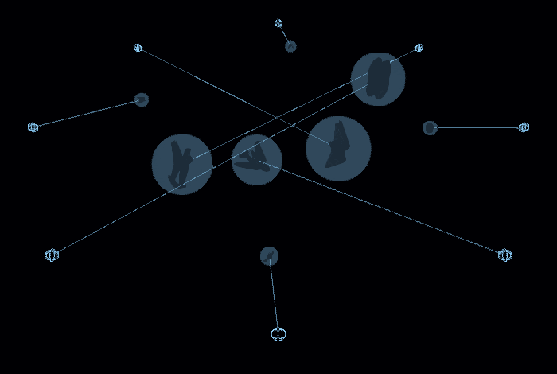

# Navigation sandbox

`Tests/NavigationSandbox` runs navigation scenarios with nobody at the window. It spawns each scenario's ships in an empty scene, steers them through a `NavWorld` (see [navigation maths](../../engine/nav.md)), logs what happens and ends with an exit code, so a script or CI can run it and judge the result.

Code: `script/States/App/Tests/NavigationSandbox.lua` and `script/States/App/Tests/NavigationSandbox/`.

## Running it

- `cargo run -p ltr -- NavigationSandbox` runs every scenario in turn, in the order of `SCENARIO_NAMES`.
- `cargo run -p ltr -- NavigationSandbox/<Name>` runs one scenario, for example `NavigationSandbox/HeadOn`.

`Slice` is not in `SCENARIO_NAMES`: it has 100 ships and takes much longer, so it is run on its own, `NavigationSandbox/Slice`.

Each scenario is a module of its own in `NavigationSandbox/`, and that module is an app: it returns `NavigationSandbox.ScenarioApp(scenario)`, a subclass of the sandbox that runs only that scenario. Selecting a scenario needs nothing but the app name.

## Scenarios

A scenario is a table:

| Field | Meaning |
|---|---|
| `name` | Name in the log lines and the HUD |
| `ships` | One entry per ship: `start`, and either `target` (the ship stops there) or `route` (waypoints flown in a loop, the first one first), each `{ x, y, z }` in metres; `facing`, the direction the ship faces at the start (not along the y axis), toward its first target by default; `targetFrame`, with a `Plan` behaviour: the index of an obstacle the goal rides on, which makes `target` an offset from that obstacle's centre in metres (world axes) and needs `facing`; `hull`, an `Enums.ShipHulls` value that sets the ship's size, Solo by default |
| `ships[i].behaviour` | Optional, instead of `target` and `route`: `{ kind = … }` with `Seek` (`through`: points passed once, then the ship arrives at `target`; each pass is judged against `passRadiusM`; optional `passSpeedShare`: the fraction of top speed each point is passed at, with braking for it, `speedCapShare`: a speed cap as a fraction of top speed, `measureTurn`: log the tightest turn the ship flew), `Hold` (`holdAtSpeed`: the fraction of top speed at which the ship is switched from flying to `target` to holding its position), `Pursue` (`obstacle`: the circling obstacle's index, `standOffM`), `Follow` (`ship`: the leader's index, `offsetM = { right, up, forward }` in the leader's axes) or `Orbit` (`obstacle`, `radiusM`, `normal`) or `Orders` (`orders`: a list of [orders](navigation.md) given to the ship in turn, see [Order ships](#order-ships)) or `Plan` (`target` is the goal, or its offset with `targetFrame`; `passRadiusM` as for Seek: the ship asks the [system planner](system-planner.md) for a path and passes its waypoints). Distances are in metres |
| `obstacles` | Optional spheres: `radius` in metres, and either `position` `{ x, y, z }` for a static one or `circle = { centre, radius, periodS }` for one that moves on a circle in the xz plane, starting on the +x side and moving toward +z. A moon has `circle = { around = <index of an earlier obstacle>, radius, periodS }` instead of `centre`: it circles that obstacle's position |
| `zones` | Optional cost zones: `position` `{ x, y, z }` and `radius` in metres, `pathCost`, and `tags`, names from the `ZoneKind` group. Each is a zone entity with a sphere shape, a path cost and tags, not a physics body: ships fly through it, and a Plan ship's request carries it weighted by the ship's profile |
| `ships[i].costProfile` | Optional, a name from `Enums.CostProfile`: the ship's `CostProfile` component. A ship without one plans with the zones' path costs as authored |
| `ships[i].costProfileChange` | A Plan ship with a profile: `{ afterPlans, to }`. Once the ship has taken `afterPlans` plans, its profile becomes `to`, which makes it ask for a new plan |
| `ships[i].expect` | A Plan ship: `{ zone, replans }`. `zone` is `"avoid"` (the ship's centre never enters a zone's sphere) or `"cross"` (it enters one); `replans` is how many times the ship asks for a new plan |
| `ships[i].joinAtS`, `ships[i].joinsSlotOf` | A ship that becomes an agent only `joinAtS` seconds of simulated time in. Its body is in physics from the start and the agents sense it as an obstacle until then. `joinsSlotOf` is the index of an earlier ship with `removeAtS`: the run fails unless the ship gets the agent id that one had |
| `ships[i].removeAtS` | The ship stops being an agent after this many seconds of simulated time (`NavWorld:removeAgent`). Its controls are released and its body stays in physics, so it coasts and the agents sense it as an obstacle |
| `safeRadiusFactor` | Optional, 1 by default: the planner's safe radius of every obstacle is its radius times this factor |
| `timeLimit` | Seconds of simulated time for every ship to finish; 120 by default. Route ships never finish, so a scenario with them runs to its limit |
| `avoidance` | Optional `{ horizonS, clearanceRadii, aimFactor }` passed to `NavWorld:setAvoidanceTuning`; the engine defaults when absent |

Every ship is a fighter from `ShipGenerator` with the Solo flight profile, built from one fixed seed, so a run is repeatable up to the variable frame time. `hull` changes only the size (the mesh scale and so the bounding radius), not the flight profile. An obstacle is a kinematic unit-sphere body scaled to its radius, owned by an entity, so a physics query reports it by entity id. A circling obstacle gets a kinematic target before each physics step, the position it will have at the end of the step, so physics and the `NavWorld` see its velocity.

| Scenario | What it checks |
|---|---|
| `SingleShip` | One ship flies to a point behind it and to one side: it turns, flies and stops |
| `HeadOn` | Two ships fly to each other's start along the same line |
| `CrossingStreams` | Two streams of four ships, abreast and 800 m apart, cross at right angles at the origin at the same time |
| `CircleSwap` | Eight ships on a 5 km circle each fly to the opposite point, so all meet at the centre; hulls alternate Solo and Medium |
| `ObstacleField` | Three ships abreast, 600 m apart, fly 20 km along x through six static spheres: four on the courses, two beside them |
| `SeekThrough` | One ship is sent through three points with Seek and then stops at a target with Arrive: each pass must be at half of top speed or more |
| `SpeedCap` | Three ships far apart. One flies 60 km under a cap of half of top speed. One is sent through two points with a pass speed of half of top speed. One passes a right-angle corner at 0.3 of top speed, and its tightest turn is logged. The cap and each pass speed must be kept, within a tolerance |
| `HoldAfterCruise` | One ship is switched to Hold at half of top speed: it brakes, comes back to the point it was switched at and stops |
| `PursueRock` | A rock circles on a 4 km circle in 120 s; two ships pursue it to 200 m from its hull, one starting ahead of it and one behind |
| `FollowLeader` | A leader flies 15 km and stops; three followers start in slots, 1.5 km to its left, 1.5 km to its right and 1.5 km directly behind it, and hold them. A follower doesn't avoid its leader, and the leader doesn't dodge a follower behind it, so none may touch it |
| `OrbitRock` | A rock circles on a 3 km circle in 200 s; two ships go once round it, at 1.5 km and 2.5 km, one starting in the plane of its circle and one 4 km above |
| `SystemCrossing` | A static star, two planets on circles and a moon of the outer planet, at tens of kilometres. Four Plan ships: one crosses the star (a static detour), one flies toward a place the inner planet is at now but not when the ship gets there (no detour), one flies toward a place the moon is not at yet but will be (a detour), and one flies to a point 1.5 km from the moon that rides on it, around the outer planet (a detour in the outer planet's frame, then a goal in the moon's frame). Each plan must come back with status `Ok` |
| `CostZoneReplan` | One belt zone (12 km radius, path cost 1, tagged `AsteroidField`) across three parallel 160 km lanes. A Cautious ship (the belt costs ten times its path cost) goes round the belt; a Bold ship (weight zero) crosses it; a ship that starts Bold and becomes Cautious once its first plan has come asks for a new plan from where it is, which goes round the belt. Each plan must come back with status `Ok`, and the ships' `expect` is checked |
| `AgentRemoval` | Agents come and go. Ship 1 flies along z with ship 2 behind it in the same lane, and ship 3 flies a lane beside them. Ship 1, the first agent, is removed 1.5 s in: its body coasts and slows in the lane, so ship 2 must sense it as an obstacle (the run has a ship–ship collision if the removed body is still left out of ship 2's scene). Ship 4 waits as a body at rest, off every lane, and joins at 2 s into the slot ship 1 freed. The others keep their agent ids and arrive, and so does ship 4 |
| `OrdersMoveTo` | Three order ships, hundreds of kilometres from the bodies. One has a MoveTo to a body that circles the origin, and is done at the body's stand-off wherever the body is by then. One has a Patrol through three points past a small body on its second leg. One has a MoveTo to a point and then a Hold, and is judged by holding the place at rest |
| `OrdersOrbit` | Two order ships, each with an Orbit order of a body that circles on its own. One names the plane (the xz plane), one names none, so the plane is the one the ship is in when it gets to the circle. Each starts outside the circle, is flown to it by the order's plan and is judged on a circle of 600 km, a part of a turn about the body (see [Order ships](#order-ships)) |
| `OrdersFollow` | A leader with a MoveTo, and two followers with a Follow order, one in a slot 1.5 km to the leader's right and one 1.5 km behind it. They start at their slots, within the range from which a Follow order keeps its slot without a plan, and hold them once the leader has stopped. None may touch the leader or each other |
| `Slice` | 100 ships loop through four waypoints each among 60 asteroids (100–800 m) in a 20 km × 2 km × 20 km slab, and a 3 km planet that circles the middle on a 6 km circle in 60 s. A seeded generator keeps every waypoint and start at least 1 km from the surface of every asteroid and from the planet's whole path, so a waypoint never lies inside a ship's avoidance reach (the scenario's aim factor of 1.4 widens the reach, so a nearer waypoint can't be approached); it runs for 60 s with its own avoidance tuning. It is the measurement for the navigation budget |

## Scene

The scene is a fresh physics world per scenario, the ships and obstacles, and an orbit camera that looks at the centre of all starts, targets and obstacles from above.

The physics step is at most 0.05 s. The first frame loads shaders and assets and can take seconds, and a step that long would carry ships at full speed through kilometres, past each other and any obstacle, so a long frame advances the simulation by the cap only. There is no star system. In place of a generated skybox, the sandbox pushes one small cube map of a uniform dim grey as both `envMap` and `irMap`, which the lighting shaders read; the irradiance of a uniform environment is the environment itself.

## Debug drawing

`Support/NavDebugDraw.lua` draws lines and spheres at world `Position`s. The render pipeline draws with the eye at the origin, so the helper subtracts the eye from each point in double precision (`Position:relativeTo`) before it reaches `Imm.Line3` and the sphere draw. Lines are `Imm.Line3`. A filled sphere is a unit `Mesh.BoxSphere` drawn into the open scene pass with the additive pipeline, the `wvp` vertex shader and the `flat_color_draw` fragment shader (the colour is `drawUser[0]` of the `DrawBlock`). A wireframe sphere is three `Imm.Line3` great circles. A render function calls `begin()`, the draws, then `finish()`.

A sphere is never drawn smaller than a fixed angular radius as seen from the eye: its radius is `max(radius, distance · MIN_ANGULAR_RADIUS)`. Ships are tens of metres across and the scenarios span kilometres, so at the framing distance a ship is far below a pixel; the angular minimum keeps it visible at any distance without depending on the field of view or the window size.

The sandbox draws, in the additive pass, for each ship:

| Marker | Meaning |
|---|---|
| Filled sphere at the ship | Its state: blue flying, green arrived, red deadlocked; yellow-green while a Pursue or Follow ship is on station and not yet arrived (being timed, or waiting for its leader to stop) |
| Wireframe sphere at the target | The arrival range; for Pursue, Follow and Orbit, at the station point the judging uses |
| Line from the ship to its target | The straight course, while the ship is flying |
| Grey filled sphere at an obstacle | Its radius |

Filled spheres are drawn at a small fraction of their colour: the additive pass is exposed for dim content, and a full-strength fill saturates to white.

## Steering

The sandbox creates a `NavWorld` over the scenario's physics world. Each ship is an agent (its flight profile's drags, thrusts and torques; the mass and inertia come from its body), sensing is turned on with `setSensing` so each ship finds the obstacles (kinematic bodies in the physics world) with a ball query, and each ship's behaviour is set once every agent is registered: `setArrive` to its target with the arrival range as radius, or the behaviour its spec asks for. The maths is in [navigation maths](../../engine/nav.md); the sandbox only runs the frame:

- **PreSim.** `NavWorld:step()`, then the glue: the agents of ships whose `removeAtS` has come are removed and the ships whose `joinAtS` has come are added (removals first, so a ship that joins at once takes the freed slot); `copyAxes` and `copyArrived` over `slotCount()` agents into two preallocated buffers with room for every ship; a route ship that has arrived gets its next waypoint (`setArrive`), a Seek ship that has passed a point gets the next one and then `setArrive`, a Hold ship is switched with `setHold`, a finished ship's behaviour is cleared once (`clearBehaviour`; not for ships that track a moving point, which keep it), and each ship's six axes are written into its `ControlInputComponent`, like any other writer (see [flight control](../flight.md)).
- **Sim.** `ShipFlightSystem` turns the control inputs into forces, the circling obstacles get their kinematic targets, and the physics world steps.

A ship that has finished has no behaviour, so it gets zero axes and drag brings it to rest. A ship that is not an agent (yet to join, or removed) is not written to: a removed ship's control input is cleared when it is removed. The `NavWorld` is dropped before a scenario's bodies are removed, because the registered agents' bodies must stay in physics while it exists.

### Order ships

A ship with `behaviour = { kind = "Orders", orders = { … } }` is flown by [`Nav.order`](navigation.md), not by the sandbox's `NavWorld`. Each order is a `SandboxOrderSpec`:

| Field | Meaning |
|---|---|
| `kind` | `MoveTo`, `Patrol`, `Hold`, `Orbit` or `Follow` |
| `obstacle`, `point` | MoveTo: the obstacle's index, or a point `{ x, y, z }` in metres. Orbit: the obstacle's index |
| `points`, `loop` | Patrol: points in metres, and whether it loops |
| `altitude`, `normal` | Orbit: the order's altitude in target radii and, optionally, the plane's normal |
| `radiusM`, `turnRad` | Orbit: the circle the ship is judged on, in metres (written in the scenario, not taken from the order's maths), and the angle it must turn about the centre, in radians (a whole turn by default) |
| `ship`, `offsetM` | Follow: the leader's index, and the slot `{ right, up, forward }` in the leader's axes, in metres |

The sandbox calls `Nav.attach` over its physics world when a scenario has an order ship, gives each such ship its orders, and calls `Nav.detach` before the bodies leave physics. The ships are not agents of the sandbox's own `NavWorld`. A physics query would show each world the other's ships as obstacles, so a scenario with order ships has no agent ships.

The ship is judged by its last order, by the rules above: a MoveTo or a Patrol has arrived when its order is `Done`; a Hold, when the ship holds the place where the order began, at rest; an Orbit, by the Orbit rule on the circle `radiusM` in the plane the scenario names, or, when it names none, in the plane the order chose (`getChosenNormal`); a Follow, by the Station rule. An order that is `Failed` or `Cancelled` counts as a deadlock, and the deadlock timer doesn't run for an order ship.

An Orbit order's circle is its stand-off, hundreds of kilometres from a body, and a ship at its speed there needs minutes for a turn, so the scenario sets `turnRad` and judges a part of one. A Follow ship that starts beyond the range of the travel drive's shortest leg would have to be flown to its slot by a plan, and the sandbox's ships have no travel drive, so the scenario has none; that join is checked in `Navigation.OrdersTest`.

## Metrics

`Support/ScenarioMetrics.lua` updates every ship after each physics step and logs each event as it happens, prefixed `NavigationSandbox: <scenario>:`. Its thresholds are named constants in metres and seconds, converted to game units with `UniverseScaleConfig:toGameUnits`.

| Metric | Definition |
|---|---|
| Arrival | Within 100 m of the target and slower than 50 m/s. A route ship never arrives |
| Waypoint | A route ship's goal is reached when the `NavWorld` reports it within 100 m (positional, no speed condition); the ship then gets the next one |
| Seek pass | A Seek ship passes a point when the `NavWorld` reports it within `passRadiusM`; the pass is too slow below half of its top speed. A ship with a pass speed or a cap is judged the other way: the pass is too fast above the lower of the two by more than a tolerance (35 %, the lag of the velocity loop behind the braking curve) |
| Speed cap | A ship with `speedCapShare` fails if its largest speed over the whole flight is more than 5 % above the cap. The largest speed and the cap are logged |
| Turn | A ship with `measureTurn` logs its tightest turn: the smallest radius, speed over the rate the velocity turns at between two frames, while it flies above a tenth of top speed, with the speed there and the share of its forward thrust that turn needs, `√(s⁴/r² + k²s²) / a`, the quantity Orbit holds at `ORBIT_THRUST_SHARE`. Logged, not judged |
| Station | A Pursue or Follow ship is on station when it is within 100 m of the point the sandbox computes from the definition (the stand-off point on the line of sight, or the slot in the leader's axes) and slower than 50 m/s relative to the tracked body; it has arrived when it has held that for 5 s. A Follow ship is judged only once the leader has stopped. The largest distance from the point after the ship first reached it, and the largest turn rate while it was held on station, are logged, not judged |
| Orbit | An Orbit ship has arrived when it has turned once about the centre, measured about the normal, while staying within 10 % of the radius (at least 100 m) of the circle; leaving the circle after the turn has begun restarts it. The tolerance is wider than the arrival range because the wanted velocity is the circle's tangent, and a ship at kilometres per second runs a little wide of it |
| Hold | After the switch the ship must leave the arrival range, then arrive back at the point it was switched at |
| Deadlock | Not 10 m closer to the target than its best distance for 10 s of simulated time; reaching a waypoint restarts the count. Not checked for a ship that tracks a moving point once it has been on station, nor for a Hold ship after the switch. The log line gives the distance, the speed, and the two nearest obstacles, each with its distance from the ship's centre to its surface and that distance as a multiple of the ship's reach (surface plus ship radius plus its largest clearance), then the gap between their two surfaces |
| Collision | A ship's bounding sphere starts to overlap another body. A `queryRadius` over the sphere finds the bodies, and each pair is counted once while it stays in contact. A body that is not a sandbox ship is an obstacle, so the count is split into ship–obstacle and ship–ship. The log names a body by its label (`ship 3`, `obstacle 2`) and gives the ship's speed; for an obstacle it also gives the speed the ship closes on it at (relative to the obstacle, which can move) |
| Frame time | Mean and largest frame time in ms, leaving out the first frame, which pays for spawning |
| Navigation time | Per frame, in ms with a monotonic clock, mean and largest, leaving out the first frame: the `NavWorld` step, the glue after it (copies, goals, control inputs) and the actuation, and their sum. Physics is not included |

| Plan | A Plan ship sends a snapshot of the obstacles (their orbits at that sim time, with the safe radius) to a worker (`Support/PlanClient.lua` on the shared `Shared/Helpers/PlanClient.lua` and `SystemPlannerWorker.lua`) and flies at its goal meanwhile. The plan's status, waypoint count and times, the kernel time in the worker and the latency from send to receipt (polled once a frame, so with the frame's granularity) are logged. The first plan to arrive is followed by one repeat request, a probe, whose latency is that of a worker that is already running; the first one includes starting the worker's Lua state. The smallest distance from the ship to each safe sphere is logged, not judged. A waypoint is an obstacle and an offset, so the ship resolves it with the obstacle's position every frame and re-aims `setSeek` at the result. A corner with an arc is flown in three phases (`Support/ShipBehaviour.lua`): the *approach* seeks the arc's entry with the corner's speed as the pass speed; on the *arc* the speed cap is the corner's speed and `setSeek` aims at a carrot on the arc a short way ahead of the ship's angle about the centre (pure pursuit, `ARC_LOOKAHEAD_S` of travel, at most `MAX_ARC_LOOKAHEAD` radians), clamped to the exit; at the exit the cap is lifted and the next corner starts. The arc is built each frame by `SystemPlanner.cornerArc` from the corner as it is now, with its neighbours at their planned offsets from it, so it is the arc the kernel cleared even for a corner on a moving obstacle. A sharp corner (radius zero) is passed with `setSeek` at the corner and its pass speed. For each arc the log gives its planned radius and speed, the speed it was entered at, the largest distance from the arc and the share of forward thrust the ship used at its peak speed, none of it judged. A goal on an obstacle is flown with `setArriveRelative`, from the start (before the plan comes) to the end, and judged at rest relative to the obstacle |
| Replan | A Plan ship keeps the revision of its cost profile that its plan was requested under. When the revision differs (`ShipBehaviour.planIsStale`), the ship drops its follower and the reply it waits for, and asks for a new plan from where it is at the current simulated time, flying at the goal meanwhile. A plan's times count from its request, so the obstacle frames given to the follower are shifted by that time. The new plan is one more plan to expect. The smallest distance from the ship's centre to each zone's sphere (negative: inside it), the plans taken and the requests made again are logged |

The worker is started with the first scenario that has a Plan ship and runs until the engine stops it at shutdown: a worker stopped from Lua stays registered, so it could not be started again. At the end of a scenario its unanswered requests are dropped and their replies discarded.

A ship that arrives or deadlocks is finished, and so is one that was removed (it is not judged any more). A ship yet to join is unfinished. The scenario ends when every ship is finished or the time limit runs out, with two summary lines: arrivals, waypoints and Seek points reached, collisions by kind, deadlocks, unfinished ships, simulated time and frame times; and the navigation times.

Collisions are counted from bounding-sphere overlap instead of from the physics contacts, because the physics contact graph also holds pairs whose bounding boxes merely overlap.

## Pass and fail

A scenario fails on a ship–obstacle or a ship–ship collision (a removed ship's body counts as a ship), on a deadlock (an order that fails or is cancelled counts as one), on a ship that joins into another slot than the one it was to take, on a Seek point passed at the wrong speed, on a ship flying over its cap, when a ship that was to arrive (reach its station, finish its turn) is still flying at its time limit (route ships fly on by design), or when a Plan ship's plan never arrives or its status is not `Ok`, or when a ship does not do what its `expect` says (it enters a zone it was to avoid, keeps out of one it was to cross, or asks for another number of plans). A run fails on a failed scenario or on a Lua error. The failure is a warning line, so the remaining scenarios still run, and the app quits with `Core.ExitCode.Failure` after the last one.
Collisions are found after each physics step, so a ship that crosses a small obstacle between two checks is missed: the count is a lower bound.

`Slice` (100 ships at cruise speed among rocks and a moving planet) is the hardest scenario and does not pass the rule yet: a few ship–planet contacts and deadlocks in narrow gaps remain (see Limits in [navigation maths](../../engine/nav.md)). The failure is real, so it stays out of the CI smoke runs, and its debug run takes most of the app run limit.
