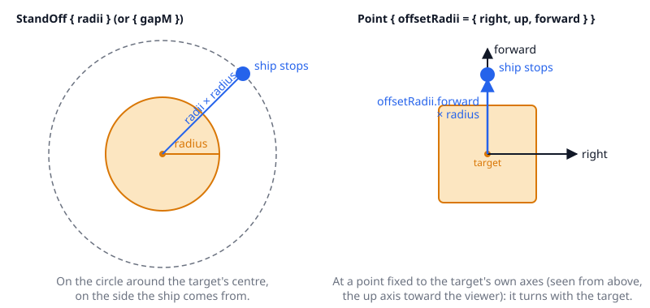
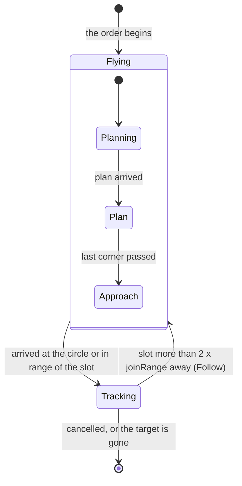
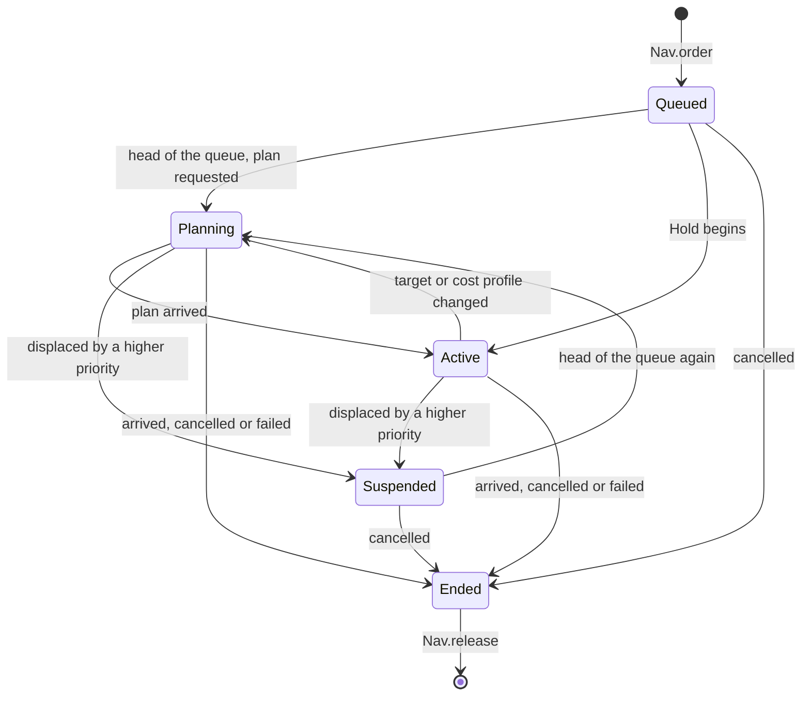

# Navigation orders

An order tells a ship where to go. The issuer (a script, an AI, a designer's tool) gives a ship an order with `Nav.order`, reads the order's status and progress while it runs, and releases it when it has ended. The module is `Modules/Navigation`; `local Nav = require("Modules.Navigation")`.

An order is an entity of its own, linked to its ship by the ship's id. Orders are for ships that no player pilots: the order system writes the ship's `ControlInputComponent` every frame, as the player controller does for the player's ship, so the two must not steer one ship.

## Using orders

```lua
Nav.attach(physics)                          -- once, with the physics world the ships are in
local order = Nav.order(ship, Nav.Orders.MoveTo { target = planet, facing = { target = enemy } })
-- later
if Nav.status(order) == Enums.NavOrderStatus.Done then Nav.release(order) end
```

| Call | Contract |
|---|---|
| `Nav.attach(physics)` | Creates the navigation world over `physics`, which steers the ships that have orders. The bodies of those ships must stay in `physics` while their orders run. There is one world at a time. |
| `Nav.detach()` | Cancels the orders that have not ended and destroys the world. Call it before the ships' bodies leave `physics`. |
| `Nav.order(ship, spec)` | Gives the ship an order behind the orders it has, and returns the order entity. The ship needs a rigid body. |
| `Nav.cancel(order)` | Asks for the order to end as `Cancelled`; the system ends it at its next update. |
| `Nav.retarget(order, target)` | Changes the target of a MoveTo; the path is planned again. |
| `Nav.status(order)`, `Nav.failure(order)`, `Nav.progress(order)` | The order's status, the reason it failed (`nil` until it has), and its progress. |
| `Nav.release(order)` | Destroys an order that has ended. It is an error to release one that has not. |
| `Nav.update(dt)` | One update of the order system, for an app that steps the simulation itself. A game that runs frames gets the update at `PreSim`, and must not call this too. |

### Kinds of order

| Spec | The ship |
|---|---|
| `Nav.Orders.MoveTo { target, approach, facing }` | Flies to `target`, an entity or a `Position`. For an entity it stops where its [approach](#approach-specs) says: `approach` names a spec, and without it the target's kind decides. For a point it stops within `NavConfig.pointArrivalM` of it, and an `approach` for a point is an error. It ends `Done` there. |
| `Nav.Orders.Patrol { points, loop, facing }` | Flies to each point in turn, as a MoveTo to a point. Without `loop` it ends `Done` at the last point; with it, it goes back to the first and never ends. `progress.waypointIndex` is the point it flies to. |
| `Nav.Orders.Hold { facing }` | Stays where it was when the order began, and brings the ship back if it drifts. It never ends by itself: cancel it. `Nav.Orders.Hold()` has no facing. |
| `Nav.Orders.Orbit { target, altitude, normal, facing }` | Circles `target`, an entity with a rigid body, anticlockwise about `normal`, at a radius of `altitude` target radii from its centre (at least 50 game units, as a stand-off; `NavConfig.standOffRadii` when `altitude` is `nil`). `altitude` must be more than 1. It never ends by itself: cancel it. See [Orbit and Follow](#orbit-and-follow). |
| `Nav.Orders.Follow { target, offset, facing }` | Keeps a slot at `offset`, a `Vec3d` of metres (right, up, forward) in the leader's own axes, and matches the leader's velocity. `target` is an entity with a rigid body. It never ends by itself: cancel it. See [Orbit and Follow](#orbit-and-follow). |

Every spec also takes `priority`, a level of `Nav.Priority` (`Routine`, `Urgent`, `Combat`; `Routine` when `nil`). See [Queue and status](#queue-and-status).

A MoveTo flies the path of the [system planner](system-planner.md#consumers): in normal flight while the plan is out, then the plan's corners with the travel drive on its drive legs, then the approach, as the autopilot does (`PlanFlight` is the code they share). A change of the order's target, or of the ship's cost profile (`CostProfileComponent`), makes the system drop the plan and plan again from where the ship is.

A MoveTo to an entity doesn't lead a moving target; the autopilot does.

### Approach specs

An `ApproachSpec` says where a ship stops at an entity. It is data, like a cost profile: the ids are in `Enums.ApproachSpec`, the defaults in `Shared/Definitions/ApproachSpecDefs.lua`, and a spec is checked when it is made (a bad one is an error, not a default). `approach` takes an id, a table of fields for an inline spec (without an `id`), or a spec.



| Kind | Fields | The ship stops |
|---|---|---|
| `StandOff` | `radii` or `gapM`, exactly one | `radii` target radii from the target's centre, at least 50 game units; or `gapM` metres from its hull. On the side it comes from, within half the distance between the hull and that circle. |
| `Point` | `offsetRadii = { right, up, forward }` | At the offset from the target's centre, in target radii along the target's own axes, within `NavConfig.pointArrivalM`. The point is worked out from the target's position and rotation at every update, so it travels with the target. |

The default of a target is chosen by its kind (a marker component): a planet, a moon and an asteroid have a `StandOff` of `NavConfig.standOffRadii` radii; a space station has a `Point` one and a half radii ahead of it (`forward`). Any other entity has the generic `StandOff` of `NavConfig.standOffRadii`.

A turn of the target does not make the order plan again: the point moves with it, and the ship follows it in the final approach.

### Orbit and Follow

Orbit and Follow keep the ship with a body that moves, so they never end by themselves. They have two phases, and the order moves between them:



While it flies, the order is a MoveTo to the point where tracking begins: the plan, its corners with the travel drive on the long legs, then the final approach, flown by the same code as a MoveTo (`PlanFlight`). The goal of an Orbit is the target's centre with the orbit radius as the distance to stop at. The goal of a Follow is the slot, which moves with the leader: the plan is made again only when the slot has moved more than `joinRange` from where the plan ends, so a leader that cruises on doesn't make the follower plan every frame.

While it tracks, the order stops flying a plan: the navigation world holds the Orbit or Follow behaviour of the ship, which steers it onto the circle or the slot as the body moves, and the drive is released. `progress.distanceLeft` is then the distance from the circle or the slot, and `eta` is 0. The status is `Active`.

- **Orbit radius.** `max(50 game units, altitude × target radius)`: the stand-off of a [StandOff approach](#approach-specs) with `radii = altitude`, since the ship goes to that distance first.
- **Orbit plane.** With a `normal` the ship circles about it. Without one, it circles in the plane that holds the target's centre and the ship's position and velocity relative to the target, taken when the final approach ends and kept from then on. When these are along one line (a ship that arrives head-on), the plane is the one that holds the radius and the ship's up axis. The order records the normal it chose (`getChosenNormal`).
- **Follow range.** `joinRange` is the shortest leg the travel drive flies (`PlanFlight.driveMinLength(0)`, 5000 game units). A follower whose slot is within it tracks at once, with no plan; the slot is nearer than the drive's shortest leg, so a plan could not use the drive. Beyond it, the follower plans to the slot and joins when it is within `joinRange`. A tracking follower whose slot is then more than 2 × `joinRange` away goes back to planning; the gap between 1 and 2 times keeps a follower at the edge from switching every frame.

A target or leader that is destroyed ends the order `Failed` with `TargetLost`, in either phase. Orbit and Follow take `facing` like the other orders; a ship with a facing flies without the drive.

### Facing

`facing = { target }`, with an entity or a `Position`, makes the ship hold its nose toward the target while the order runs, whatever the order flies to. The entity is followed as it moves, and when it is destroyed the order ends `Failed` with `TargetLost`. The facing is a separate goal: with none, the nose follows the course.

The nose goes to the facing whenever the ship is not accelerating harder than its side thrusters can steer: then the main thruster has to point along the acceleration, and the facing waits until the ship cruises or brakes. A ship with a facing flies without the travel drive, since the drive thrusts along the nose; the plan for it has no drive leg. A facing point closer than the ship's own radius gives no facing (the nose keeps the course).

## Queue and status

A ship's orders are in its `OrderQueue`, ordered by priority: an order goes behind the orders of its priority or a higher one, and before the lower ones, so within a level they are in the order they were given. Only the first one, the head, runs; the others are `Queued` and wait. When the head ends, the next one begins. An order that is given with a higher priority than the head becomes the head, and displaces the one that was running (see below). A ship with an order is an agent of the navigation world; when its queue empties, the agent is removed, the control input is cleared, the travel drive is told to disengage and the ship drifts.



`Ended` stands for one of three statuses: `Done` (arrived), `Failed` and `Cancelled`. Of the two reasons an order fails (`Nav.failure`), `TargetLost` is a MoveTo whose target entity has been destroyed, and `ShipLost` an order whose ship entity or body is gone. Cancelling a queued order ends it without it ever having begun.

A `Suspended` order is one that had begun and was displaced. The system drops its plan, stops tracking and tells the travel drive to disengage; what the order itself holds stays (a Patrol's point, an Orbit's chosen plane, the target, the facing). When it is the head again it resumes: it begins as new, from where the ship is, so a goal order plans again and a Hold holds where the ship is then, not where it began. Cancelling a suspended order ends it `Cancelled` and it never resumes. Because a Hold is displaced by a higher priority, it no longer blocks the orders behind it.

`Nav.progress(order)` has `distanceLeft` (game units to the stand-off point or point), `eta` (seconds) and, for a Patrol, `waypointIndex`. The system writes them while the order is the head, and they are `nil` before that.

## Events

An order's end, and its suspension and resumption, are announced on the event bus, unscoped, with the order's entity id as the payload:

| Event | The order |
|---|---|
| `Event.NavOrderDone` | has arrived |
| `Event.NavOrderFailed` | has failed; ask `Nav.failure` why |
| `Event.NavOrderCancelled` | was cancelled |
| `Event.NavOrderSuspended` | was displaced by an order of a higher priority |
| `Event.NavOrderResumed` | is the head again and runs once more |

The events are delivered at `FrameStage.PostSim`, so they arrive in the frame loop, not inside the call that changed the order. The order's components stay readable until it is released. A subscriber compares the payload with the ids of the orders it issued.

## Lifetime

The issuer releases an order. The system never destroys one, so a finished order's status stays readable to whoever holds it; an order that is not released stays in the registry. Destroying a ship destroys its queue but not its orders: they fail with `ShipLost` and then wait for their issuer's release.

## Values

`Config/Navigation/NavConfig.lua` holds what orders fly by, authored in metres and converted to game units on use: `pointArrivalM`, the distance from a point at which a ship has arrived, and `standOffRadii`, the stand-off in target radii of the default approach of a planet, a moon, an asteroid and any other entity.
