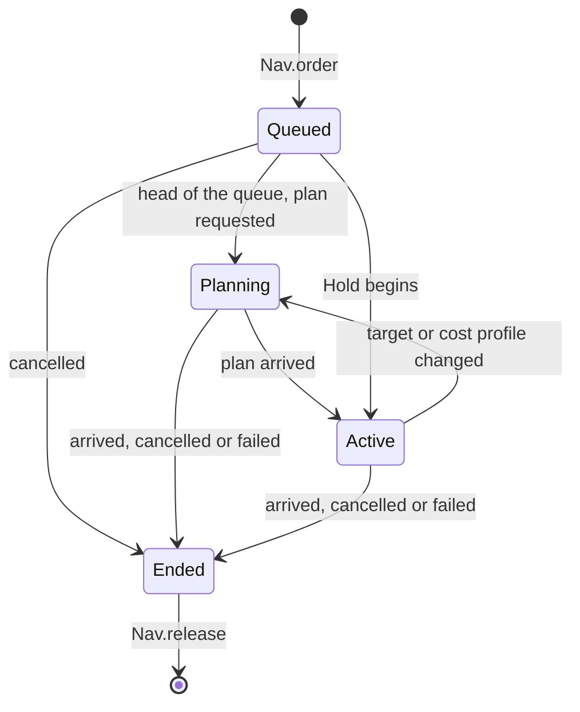

# Navigation orders

An order tells a ship where to go. The issuer (a script, an AI, a designer's tool) gives a ship an order with `Nav.order`, reads the order's status and progress while it runs, and releases it when it has ended. The module is `Modules/Navigation`; `local Nav = require("Modules.Navigation")`.

An order is an entity of its own, linked to its ship by the ship's id. Orders are for ships that no player pilots: the order system writes the ship's `ControlInputComponent` every frame, as the player controller does for the player's ship, so the two must not steer one ship.

## Using orders

```lua
Nav.attach(physics)                          -- once, with the physics world the ships are in
local order = Nav.order(ship, Nav.Orders.MoveTo { target = planet, standOffM = 20000 })
-- later
if Nav.status(order) == Enums.NavOrderStatus.Done then Nav.release(order) end
```

| Call | Contract |
|---|---|
| `Nav.attach(physics)` | Creates the navigation world over `physics`, which steers the ships that have orders. The bodies of those ships must stay in `physics` while their orders run. There is one world at a time. |
| `Nav.detach()` | Cancels the orders that have not ended and destroys the world. Call it before the ships' bodies leave `physics`. |
| `Nav.order(ship, spec)` | Gives the ship an order behind the orders it has, and returns the order entity. The ship needs a rigid body. |
| `Nav.cancel(order)` | Asks for the order to end as `Cancelled`; the system ends it at its next update. |
| `Nav.retarget(order, target)` | Changes the target of a MoveTo; the path is planned again. |
| `Nav.status(order)`, `Nav.failure(order)`, `Nav.progress(order)` | The order's status, the reason it failed (`nil` until it has), and its progress. |
| `Nav.release(order)` | Destroys an order that has ended. It is an error to release one that has not. |
| `Nav.update(dt)` | One update of the order system, for an app that steps the simulation itself. A game that runs frames gets the update at `PreSim`, and must not call this too. |

### Kinds of order

| Spec | The ship |
|---|---|
| `Nav.Orders.MoveTo { target, standOffM }` | Flies to `target`, an entity or a `Position`. For an entity it stops at a stand-off distance from the target's hull; `standOffM` is that gap in metres, and without it the stand-off is 1.5 target radii, at least 50 game units from the centre. For a point it stops within `NavConfig.pointArrivalM` of it. It ends `Done` there. |
| `Nav.Orders.Patrol { points, loop }` | Flies to each point in turn, as a MoveTo to a point. Without `loop` it ends `Done` at the last point; with it, it goes back to the first and never ends. `progress.waypointIndex` is the point it flies to. |
| `Nav.Orders.Hold()` | Stays where it was when the order began, and brings the ship back if it drifts. It never ends by itself: cancel it. |

A MoveTo flies the path of the [system planner](system-planner.md#consumers): in normal flight while the plan is out, then the plan's corners with the travel drive on its drive legs, then the stand-off approach, exactly as the autopilot does (`PlanFlight` is the code they share). A change of the order's target, or of the ship's cost profile (`CostProfileComponent`), makes the system drop the plan and plan again from where the ship is.

A MoveTo to an entity doesn't lead a moving target; the autopilot does.

## Queue and status

A ship's orders are in its `OrderQueue`, in the order they were given. Only the first one, the head, runs; the others are `Queued` and wait. When the head ends, the next one begins. A ship with an order is an agent of the navigation world; when its queue empties, the agent is removed, the control input is cleared, the travel drive is told to disengage and the ship drifts.



`Ended` stands for one of three statuses: `Done` (arrived), `Failed` and `Cancelled`. Of the two reasons an order fails (`Nav.failure`), `TargetLost` is a MoveTo whose target entity has been destroyed, and `ShipLost` an order whose ship entity or body is gone. Cancelling a queued order ends it without it ever having begun.

`Nav.progress(order)` has `distanceLeft` (game units to the stand-off point or point), `eta` (seconds) and, for a Patrol, `waypointIndex`. The system writes them while the order is the head, and they are `nil` before that.

## Events

An order's end is announced on the event bus, unscoped, with the order's entity id as the payload:

| Event | The order |
|---|---|
| `Event.NavOrderDone` | has arrived |
| `Event.NavOrderFailed` | has failed; ask `Nav.failure` why |
| `Event.NavOrderCancelled` | was cancelled |

The events are delivered at `FrameStage.PostSim`, so they arrive in the frame loop, not inside the call that ended the order. The order's components stay readable until it is released. A subscriber compares the payload with the ids of the orders it issued.

## Lifetime

The issuer releases an order. The system never destroys one, so a finished order's status stays readable to whoever holds it; an order that is not released stays in the registry. Destroying a ship destroys its queue but not its orders: they fail with `ShipLost` and then wait for their issuer's release.

## Values

`Config/Navigation/NavConfig.lua` holds what orders fly by, authored in metres and converted to game units on use: `pointArrivalM`, the distance from a point at which a ship has arrived.
