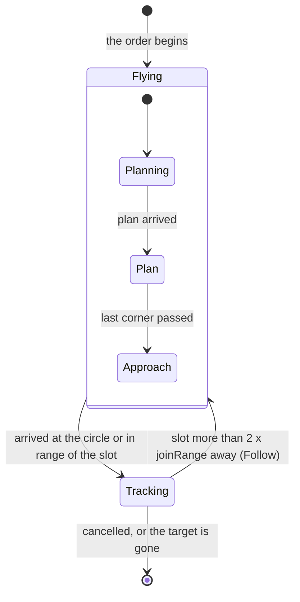
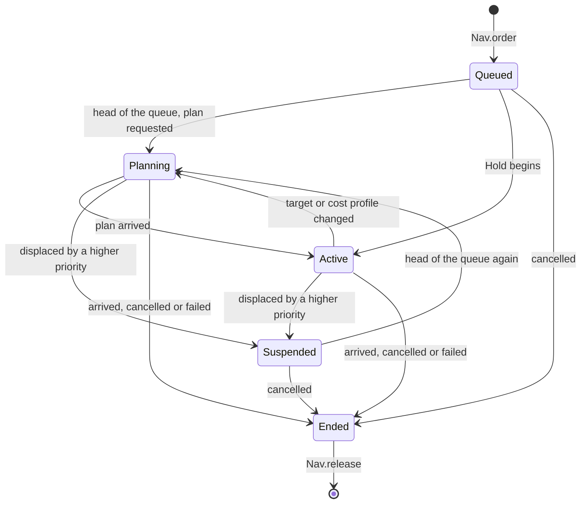
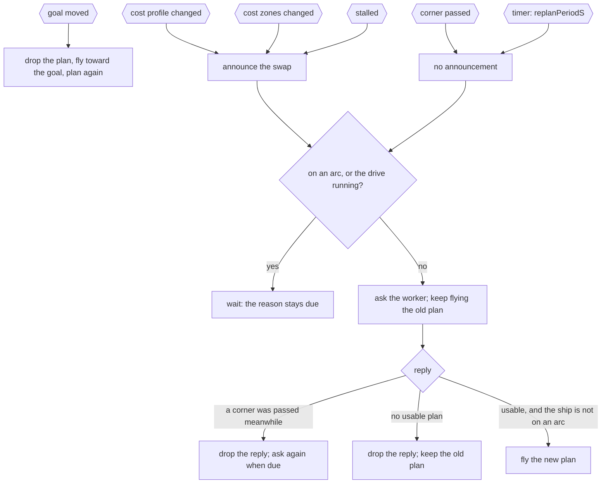

# Navigation orders

An order tells a ship where to go. The issuer (a script, an AI, a designer's tool) gives a ship an order with `Nav.order`, reads the order's status and progress while it runs, and releases it when it has ended. The module is `Modules/Navigation`; `local Nav = require("Modules.Navigation")`. To start using it, read the [navigation guide](guide.md): setup, use cases with the tests that run them, and pitfalls. This page is the contract. The navigation terms are in the [glossary](glossary.md).

An order is an entity of its own, linked to its ship by the ship's id. The order system writes a ship's `ControlInputComponent` only while orders own the ship's controls; the ship the player pilots, or one an AI has claimed, is owned by someone else and its orders wait ([control ownership](#control-ownership)).

## Using orders

```lua
Nav.attach(physics)                          -- once, with the physics world the ships are in
local order = Nav.order(ship, Nav.Orders.MoveTo { target = planet, facing = { target = enemy } })
-- later
if Nav.status(order) == Enums.NavOrderStatus.Done then Nav.release(order) end
```

| Call | Contract |
|---|---|
| `Nav.attach(physics)` | Creates the navigation world over `physics`, which steers the ships that have orders. The bodies of those ships must stay in `physics` while their orders run. There is one world at a time. |
| `Nav.detach()` | Cancels the orders that have not ended and destroys the world. Call it before the ships' bodies leave `physics`. |
| `Nav.order(ship, spec)` | Gives the ship an order behind the orders it has, and returns the order entity. The ship needs a rigid body. |
| `Nav.claim(ship)`, `Nav.unclaim(ship)` | Takes the ship's controls for the caller, who then writes the input directly, and gives them back ([control ownership](#control-ownership)). Claiming a claimed ship, or unclaiming one that is not claimed, is an error. |
| `Nav.controlOwner(ship)` | Who owns the ship's control input: an `Enums.ControlOwner` value. |
| `Nav.cancel(order)` | Asks for the order to end as `Cancelled`; the system ends it at its next update. |
| `Nav.retarget(order, target, frame)` | Changes the target of a MoveTo, and its `frame` (see [Kinds of order](#kinds-of-order)); the path is planned again. |
| `Nav.status(order)`, `Nav.failure(order)`, `Nav.progress(order)` | The order's status, the reason it failed (`nil` until it has), and its progress. |
| `Nav.route(order, out)` | The path the order has left to fly, as `Position`s now; fills `out` (a new table when `nil`) and returns it. Empty when there is none. |
| `Nav.routeFlown(order, out)` | The path the ship has flown under the order's current plan: where it was when the plan was asked for, then the corners it has passed. Fills `out` like `Nav.route`; empty when there is none. |
| `Nav.release(order)` | Destroys an order that has ended. It is an error to release one that has not. |
| `Nav.estimate(from, to, flightProfile, costProfile)` | What a flight would cost, without moving anything ([estimates](#estimates)). Runs on the calling thread. |
| `Nav.estimateMany(from, targets, flightProfile, costProfile)`, `Nav.takeEstimates(request)`, `Nav.discardEstimates(request)` | The same for many targets on a worker: the first returns a request id, the second the results in the targets' order, `nil` until they have come (and once only), the third drops a request nobody waits for. |
| `Nav.neighbours(ship, radius, filter)` | The entities near a ship ([neighbours](#neighbours)). |
| `Nav.update(dt)` | One update of the order system, for an app that steps the simulation itself. A game that runs frames gets the update at `PreSim`, and must not call this too. |

### Kinds of order

| Spec | The ship |
|---|---|
| `Nav.Orders.MoveTo { target, approach, frame, facing }` | Flies to `target`, an entity or a `Position`. For an entity it stops where its [approach](#approach-specs) says: `approach` names a spec, and without it the target's kind decides. For a point it stops within `NavConfig.pointArrivalM` of it, and an `approach` for a point is an error. With a `frame`, an entity with a rigid body, the point rides it: the order keeps the point's offset from the frame's centre, as it was when the order was given (or retargeted), and the offset is translation only, so the point does not turn with the body. A `frame` for an entity target is an error. If the frame is destroyed, or loses its body, the order ends `Failed` with `TargetLost`. It ends `Done` at the point. |
| `Nav.Orders.Patrol { points, loop, facing }` | Flies to each point in turn, as a MoveTo to a point. Without `loop` it ends `Done` at the last point; with it, it goes back to the first and never ends. `progress.waypointIndex` is the point it flies to. |
| `Nav.Orders.Hold { facing }` | Stays where it was when the order began, and brings the ship back if it drifts. It never ends by itself: cancel it. `Nav.Orders.Hold()` has no facing. |
| `Nav.Orders.Orbit { target, altitude, normal, facing }` | Circles `target`, an entity with a rigid body, anticlockwise about `normal`, at a radius of `altitude` target radii from its centre (at least 50 game units, as a stand-off; `NavConfig.standOffRadii` when `altitude` is `nil`). `altitude` must be more than 1. It never ends by itself: cancel it. See [Orbit and Follow](#orbit-and-follow). |
| `Nav.Orders.Follow { target, offset, facing }` | Keeps a slot at `offset`, a `Vec3d` of metres (right, up, forward) in the leader's own axes, and matches the leader's velocity. `target` is an entity with a rigid body. It never ends by itself: cancel it. See [Orbit and Follow](#orbit-and-follow). |

Every spec also takes `priority`, a level of `Nav.Priority` (`Routine`, `Urgent`, `Combat`; `Routine` when `nil`). See [Queue and status](#queue-and-status).

A MoveTo flies the path of the [system planner](system-planner.md#consumers): in normal flight while the plan is out, then the plan's corners with the travel drive on its drive legs, then the approach (`PlanFlight`, see [ship flight control](../flight.md#writers)). The plan is made again when something it was made under changes: see [Replanning](#replanning).

A MoveTo to an entity doesn't lead a moving target. A target the plan doesn't ride (a ship) that moves far makes the plan again.

### Approach specs

An `ApproachSpec` says where a ship stops at an entity. It is data, like a cost profile: the ids are in `Enums.ApproachSpec`, the defaults in `Shared/Definitions/ApproachSpecDefs.lua`, and a spec is checked when it is made (a bad one is an error, not a default). `approach` takes an id, a table of fields for an inline spec (without an `id`), or a spec.


| Kind | Fields | The ship stops |
|---|---|---|
| `StandOff` | `radii` or `gapM`, exactly one | `radii` target radii from the target's centre, at least 50 game units; or `gapM` metres from its hull. On the side it comes from, within half the distance between the hull and that circle. |
| `Point` | `offsetRadii = { right, up, forward }` | At the offset from the target's centre, in target radii along the target's own axes, within `NavConfig.pointArrivalM`. The point is worked out from the target's position and rotation at every update, so it travels with the target. |

The default of a target is chosen by its kind (a marker component): a planet, a moon and an asteroid have a `StandOff` of `NavConfig.standOffRadii` radii; a space station has a `Point` one and a half radii ahead of it (`forward`). Any other entity has the generic `StandOff` of `NavConfig.standOffRadii`.

A turn of the target does not make the order plan again: the point moves with it, and the ship follows it in the final approach.

For a `StandOff`, the plan goes to the target's centre, and its last leg stops the stand-off distance short, on its own line to the centre ([goal with a stand-off](system-planner.md#goal-with-a-stand-off)). The last leg therefore points at the target, on the line the final approach steers along, and the ship does not turn when the plan ends, even after a detour.

### Orbit and Follow

Orbit and Follow keep the ship with a body that moves, so they never end by themselves. They have two phases, and the order moves between them:



While it flies, the order is a MoveTo to the point where tracking begins: the plan, its corners with the travel drive on the long legs, then the final approach, flown by the same code as a MoveTo (`PlanFlight`). The goal of an Orbit is the target's centre with the orbit radius as the distance to stop at. The goal of a Follow is the slot, which moves with the leader: the plan is made again only when the slot has moved more than `joinRange` from where the plan ends, so a leader that cruises on doesn't make the follower plan every frame.

While it tracks, the order stops flying a plan: the navigation world holds the Orbit or Follow behaviour of the ship, which steers it onto the circle or the slot as the body moves, and the drive is released. `progress.distanceLeft` is then the distance from the circle or the slot, and `eta` is 0. The status is `Active`.

- **Orbit radius.** `max(50 game units, altitude × target radius)`: the stand-off of a [StandOff approach](#approach-specs) with `radii = altitude`, since the ship goes to that distance first.
- **Orbit plane.** With a `normal` the ship circles about it. Without one, it circles in the plane that holds the target's centre and the ship's position and velocity relative to the target, taken when the final approach ends and kept from then on. When these are along one line (a ship that arrives head-on), the plane is the one that holds the radius and the ship's up axis. The order records the normal it chose (`getChosenNormal`).
- **Follow range.** `joinRange` is the shortest leg the travel drive flies (`PlanFlight.driveMinLength` of the follower's flight profile: its top speed times a fixed flight time, about 53 game units for the standard ship). A follower whose slot is within it tracks at once, with no plan; the slot is nearer than the drive's shortest leg, so a plan could not use the drive. Beyond it, the follower plans to the slot and joins when it is within `joinRange`. A tracking follower whose slot is then more than 2 × `joinRange` away goes back to planning; the gap between 1 and 2 times keeps a follower at the edge from switching every frame.

A target or leader that is destroyed ends the order `Failed` with `TargetLost`, in either phase. Orbit and Follow take `facing` like the other orders; a ship with a facing flies without the drive.

### Facing

`facing = { target }`, with an entity or a `Position`, makes the ship hold its nose toward the target while the order runs, whatever the order flies to. The entity is followed as it moves, and when it is destroyed the order ends `Failed` with `TargetLost`. The facing is a separate goal: with none, the nose follows the course.

The nose goes to the facing whenever the ship is not accelerating harder than its side thrusters can steer: then the main thruster has to point along the acceleration, and the facing waits until the ship cruises or brakes. A ship with a facing flies without the travel drive, since the drive thrusts along the nose; the plan for it has no drive leg. A facing point closer than the ship's own radius gives no facing (the nose keeps the course).

## Queue and status

A ship's orders are in its `OrderQueue`, ordered by priority: an order goes behind the orders of its priority or a higher one, and before the lower ones, so within a level they are in the order they were given. Only the first one, the head, runs; the others are `Queued` and wait. When the head ends, the next one begins. An order that is given with a higher priority than the head becomes the head, and displaces the one that was running (see below). A ship with an order is an agent of the navigation world; when its queue empties, the agent is removed, nobody owns the controls any more, so the control input is cleared and the travel drive is told to disengage, and the ship drifts.



`Ended` stands for one of three statuses: `Done` (arrived), `Failed` and `Cancelled`. Of the two reasons an order fails (`Nav.failure`), `TargetLost` is a MoveTo whose target entity has been destroyed, and `ShipLost` an order whose ship entity or body is gone. Cancelling a queued order ends it without it ever having begun.

A `Suspended` order is one that had begun and was displaced. The system drops its plan, stops tracking and tells the travel drive to disengage; what the order itself holds stays (a Patrol's point, an Orbit's chosen plane, the target, the facing). When it is the head again it resumes: it begins as new, from where the ship is, so a goal order plans again and a Hold holds where the ship is then, not where it began. Cancelling a suspended order ends it `Cancelled` and it never resumes. Because a Hold is displaced by a higher priority, it no longer blocks the orders behind it.

`Nav.progress(order)` has `distanceLeft` (game units to the stand-off point or point), `eta` (seconds), `nextWaypoint` (the `Position` the ship flies to now: the plan's next corner while it flies the corners, and the goal itself while it flies the approach or the plan is out; `nil` for Orbit and Follow) and, for a Patrol, `waypointIndex`. The system writes them while the order is the head, and they are `nil` before that.

`Nav.route(order, out)` lists the path the order has left, for a map or a readout to draw. While the ship flies the corners of a plan, it is the corners not yet passed, then the goal; each corner is read as a position now, so a corner that rides on a moving body moves with it. While the plan is out and on the final approach it is the goal alone. It is empty for an order that has not begun or has ended, for an order that is not the head, and for an Orbit or Follow that tracks its target. The list changes with the flight, so a caller reads it again each frame, into the table it keeps.

`Nav.routeFlown(order, out)` is the other half, for a map to draw behind the ship: the position where the ship was when the current plan was asked for, then the plan's corners it has passed (all of them once the corners are done), each read as a position now. It is empty whenever `Nav.route` is, and also for a flight that began within range of its goal, which asked for no plan. It is the path under the current plan, not a record of the flight: a new plan, made after a retarget or a refresh, starts it again from where the ship was then.

An order is also suspended when the ship's controls go to someone other than orders (below), whether or not it is the head: a begun order becomes `Suspended` with the same event, and leaves the world with the ship's agent. An order that had not begun stays `Queued`. When orders own the controls again, the head resumes as above.

## Control ownership

One of three owners writes a ship's control input; the strongest that wants it wins:

| Owner | `Enums.ControlOwner` | Takes the controls when |
|---|---|---|
| Manual input | `Manual` | the player's controller pilots the ship (always, while it is the player's ship) |
| A claim | `Claim` | the caller has done `Nav.claim(ship)` |
| Orders | `Orders` | the ship has an order |

The owner is kept in a `ControlOwnerComponent` on the ship and is decided when what a writer wants changes, not every frame. When the owner changes, the input is reset once: the axes are zeroed, the drive's speed cap is lifted and the travel drive is told to disengage. A new owner that wants the drive requests it again. A writer that is not the owner must not write the ship's input; the order system never does, and it takes the ship's agent out of the world while another owner has the ship. A claimer writes the six axes (and the drive requests) itself each frame, as the player controller does. See [ship flight control](../flight.md#control-ownership).

`Nav.order` on a claimed or piloted ship queues the order and waits; the order begins when orders own the ship.

### The player's autopilot

The player's ship is flown by orders like any other, through `AutoPilotSystem` (`Modules/Constructs/Systems/`). `engage(ship, target, frame)` gives the ship a MoveTo of `Urgent` priority and takes manual input's want for the ship away, so orders own it; with an order already flying, it `Nav.retarget`s that order. A point target with a `frame` entity (a point on a belt, which moves with its planet) keeps its offset from that entity's body. The order flies to the point itself (a stand-off of 0), and to an entity's stand-off point.

The order ends as any order does. `AutoPilotSystem` notices it once a frame, gives manual input its want back (the ownership reset zeroes the axes and stops the drive) and releases the order. A manual takeover (see [ship flight control](../flight.md#writers)) calls `disengage`: the order is cancelled and manual input owns the ship at once, so the player's keys act in the same frame; the order system ends the cancelled order at its next update. `Nav.attach` the scene's physics world before engaging, and `Nav.detach` it when the scene goes, which cancels the autopilot's order with the others.

## Estimates

`Nav.estimate` answers "what would it cost to fly there" for AI that chooses between destinations. It plans no waypoints and moves nothing:

```lua
local e = Nav.estimate(ship, planet)             -- { reachable, time, distance, risk }
local request = Nav.estimateMany(ship, candidates)
-- later, once per frame until it is not nil
local estimates = Nav.takeEstimates(request)     -- one result per candidate, in order
```

`from` is a ship or a `Position` (a point needs `flightProfile`), `to` an entity or a `Position`. `flightProfile` and `costProfile` default to the ship's own. An entity `to` is flown to its stand-off, as a MoveTo does (`OrderGoals` is the maths both use), and a point `to` to within `pointArrivalM`.

| Result | Meaning |
|---|---|
| `reachable` | `false` when the start or the goal is inside a body's hull (a star, planet, moon or station) or the target entity is gone. `time`, `distance` and `risk` are then `nil`. |
| `time` | Seconds until the ship is within the arrival radius of the goal. |
| `distance` | The path's length in game units: the straight line times `NavConfig.estimateDetourFactor`. |
| `risk` | The cost zones' weighted cost times the length of the straight line inside each, summed (game-unit lengths): the planner's cost of crossing, which a caller weighs against `time`. 0 with no zones. A zone that holds an endpoint counts. |

**Model.** `time` is `TravelDriveMath.travelTime` of the lengthened distance, with the drive when the `from` ship has a travel drive, autopilot drive is enabled and the flight is longer than the shortest drive leg (`PlanFlight.driveMinLength` of the ship's flight profile, as a MoveTo decides), and at top speed otherwise. Where the line passes through a body's drive zone with the drive on, the zone's cap (`TravelDriveMath.zoneCap`) slows the drive: the delay is integrated over the stretches inside the zones' influence (`NavEstimate`'s `zoneDelay`) and added to `time`. It is not the plan's time: the plan's route and timeline are not computed, so a flight with a long detour, or one the drive can't take, is estimated short.

**Inputs are positions now.** The scene (bodies, cost zones) and the targets are taken where they are when the estimate is asked for. A target that moves, or a body that orbits across the line, is not led: the estimate is for the flight as if everything stood still. The line is straight, so `risk` ignores the detour a plan would make around a zone.

**Cost.** The calling thread builds the input from a [planner snapshot](system-planner.md#consumers) and the targets, which is plain numbers (`EstimateRequest`). `Nav.estimate` runs the kernel (`NavEstimate`, pure numbers) there; `Nav.estimateMany` sends it to the `NavEstimate` worker (`NavEstimateClient`, one worker, started on first use), so scoring many destinations doesn't block the frame. The batch gives the same numbers as the single form.

**Accuracy.** The detour factor is the planned path's length over the straight distance, measured in the planner sandbox scenarios (`ScenarioMetrics` logs the ratio of each plan). Those systems are sparse; a crowded one plans longer detours, and the factor then needs raising. The `OrdersEstimate` scenario logs a flight's estimated time against the time flown.

## Neighbours

`Nav.neighbours(ship, radius, filter)` lists the entities within `radius` game units of a ship, nearest first, as `{ entity, distance }` rows. `distance` is from the ship's position to the other body's surface, in game units. It reads the physics world's query index, the same one the avoidance senses through, so what a ship avoids and what an AI sees as near are one set. It needs the world attached (`Nav.attach`) and a ship with a rigid body.

- The ship is not its own neighbour. An entity whose body has several colliders is listed once, at its nearest collider. A body that has no entity is not listed.
- `filter(entity, distance)` is optional; the rows it returns `false` for are left out.
- The query runs on the calling thread, once per call. A caller that asks for many ships in a frame keeps within its own budget.

## Replanning

A plan is made for a goal, a cost profile and a set of cost zones, with the ship at rest where it was asked for. A flight plans again when one of them changes, and also on a timer, because the world moves under a plan. There are two ways to swap the plan:

- **Drop.** The goal moved: a `Nav.retarget`, a Patrol's next point, a Follow's slot that moved more than `joinRange` ([Orbit and Follow](#orbit-and-follow)), or a MoveTo's target that is not a body the plan rides (a ship) and has moved more than `NavConfig.goalDriftShare` of the ship's distance to it, and at least the goal's arrival radius, from where the plan ends. The old plan ends at a place nobody wants, so it is dropped; the ship flies toward the goal in normal flight while the new plan is made.
- **Refresh.** The ship keeps flying the old plan while a new one is made on the worker, and the new one replaces it when it arrives. The reasons are the ship's cost profile, the cost zones, a stall, a corner and the timer.



- **When a refresh is asked for.** Not while the ship is on an arc, and not while the travel drive is running or charging: the planner times a path from a ship at rest, so a plan asked for under a drive run would place the bodies late and cut the run short. The reasons stay due and the request goes out when the ship is clear. A request is also not sent when the ship is already within range of the goal.
- **When it is taken.** A reply replaces the plan once the ship is off an arc. A reply is dropped as stale if the ship passed a corner since it was asked for, because the new plan's first corner would then be behind the ship; the reason stays due. A reply with no usable plan is dropped with a warning, and the old plan is flown on. A goal change or the end of the order drops a request that is out, and so does a change of profile or zones, which asks again.
- **A refresh after each corner.** After a sharp corner is passed or an arc is flown, never in the middle of an arc.
- **The timer.** The `replanPeriodS` of the ship's [rate class](#update-rate-classes), and the first refresh is offset by a share of it taken from the order's id (`Stagger.of`), so the requests of many orders spread over frames. A plan that flies straight (no plan was usable) is not refreshed by the timer.
- **Zones.** `CostZones.signature` folds the zones' ids, path costs, radii and tags into one number. An order compares it with the one its plan was made under, so a change to any zone asks every flying order for a refresh, near the zone or not.
- **Announcement.** The swap sends `NavOrderReplanned` for a goal change, a drift, a stall, a profile change or a zone change, and not for the timer or a corner. The stall also sends `NavOrderBlocked` ([Events](#events)). A swap while the first plan is still out is a drop, since there is no plan to keep flying.

## Update-rate classes

How often a ship's avoidance runs, and how often its plan is checked, follows what is around it: often near stations and in traffic, seldom in empty space. A ship that has an agent in the navigation world has a *rate class* (`Enums.NavRateClass`: `High`, `Normal`, `Low`; `NavRateComponent` holds it), and `NavConfig.rateClasses` gives each class two periods in seconds:

| Class | `avoidancePeriodS` | `replanPeriodS` |
|---|---|---|
| High | 0 (every step) | 0.5 |
| Normal | 0.02 | 1 |
| Low | 0.05 | 2 |

Only avoidance and its sensing run at the class rate ([update rate](../../engine/nav.md#update-rate)); the steering of the order, the controller and the arrival test run at every step. The class sets the agent's avoidance period when it changes, and the replan period is read when a plan is asked for. A ship that has not been judged yet has the Normal replan period.

`NavRateSystem`, run by `NavOrderSystem` after the zones, judges a ship by the first of these that holds:

1. **A rate zone.** A ship inside a zone entity that has a `NavRateClassComponent` has its class. Inside several, it has the highest rate of them. The component is how a designer marks a station, a gate or a point of interest.
2. **Traffic.** At least `NavConfig.trafficShips` other ships (entities with a `ControlInputComponent`) within `NavConfig.trafficRadiusM`: High. The ships are found with the same physics query as [`Nav.neighbours`](#neighbours).
3. **Empty space.** No body of any kind within the ship's sensing range (`NavWorld:sensingRange`, the range avoidance senses by): Low.
4. Otherwise Normal.

A ship is judged when it first has an agent, then every `NavConfig.rateJudgePeriodS`, the first of the later judgings put off by a share of it taken from the ship's id so that ships are not all judged in one frame, and at once when it enters or leaves a zone (the same check that sends the zone events). A change of class sets the new avoidance period and refreshes the agent, so a ship that was Low and meets a rock is not left on the long period until its next run. The class is dropped with the agent.

An agent keeps the detour its last avoidance run found until the next run, so goal changes call `NavWorld:refresh`: a new order, a new plan, a new leg of a plan. A caller that steers an agent itself (a test, the sandbox) does the same when it sends the agent somewhere else, as a goal set again at every frame does not.

The classes judge by where the ship is, not by what it does. A class for ships in combat, an AI's choice of class and the autopilot's class are not made.

## Events

The events an AI listens to are announced on the event bus, unscoped. An order's events carry the order's entity id as the payload:

| Event | The order |
|---|---|
| `Event.NavOrderDone` | has arrived |
| `Event.NavOrderFailed` | has failed; ask `Nav.failure` why |
| `Event.NavOrderCancelled` | was cancelled |
| `Event.NavOrderSuspended` | was displaced by an order of a higher priority |
| `Event.NavOrderResumed` | is the head again and runs once more |
| `Event.NavOrderArrived` | has reached its goal: each point of a Patrol, the end of a MoveTo (just before `NavOrderDone`), and the ship joining the circle of an Orbit or the slot of a Follow |
| `Event.NavOrderReplanned` | is flown on a new path because what the old one was made under changed in flight: its goal (a `Nav.retarget`, a target that drifted, a Follow's slot that moved), the ship's cost profile, the cost zones, or the ship stalled. Not the first plan, nor the plan after a resume, nor the path to a Patrol's next point, nor a refresh the [timer or a corner](#replanning) asked for |
| `Event.NavOrderBlocked` | is stalled: the ship is no closer to what it flies to, see below |

A zone's events carry a table `{ ship = id, zone = id }`:

| Event | The ship |
|---|---|
| `Event.NavZoneEntered` | is inside a zone it was not inside at the last update |
| `Event.NavZoneLeft` | is outside a zone it was inside, or the zone is gone |

The events are delivered at `FrameStage.PostSim`, so they arrive in the frame loop, not inside the call that changed the order. The order's components stay readable until it is released. A subscriber compares the payload with the ids of the orders it issued.

**Blocked.** A stall is a flight that has come no closer than `NavConfig.blockedProgressM` to what it flies to in `NavConfig.blockedWindowS` seconds (`ProgressWatch`, the rule the navigation sandbox calls a deadlock). What the distance is measured to is the corner the ship flies to on a planned path, and the goal on the final approach. The event is sent once per stall; the order goes on, and progress re-arms the watch, so a ship that frees itself and sticks again is reported again. Only a flight to a goal is watched, not a Hold or an Orbit or Follow that has joined.

**Zones.** The events cover the sphere zones of the system and the ships that have orders (a claimed or suspended ship included): a ship is watched from its first order until its last one ends. The first check announces `NavZoneEntered` for the zones the ship is already inside; when its orders end the watch is dropped with no `NavZoneLeft`. The zone is its sphere: a zone with a parent that has a body is centred on it, and any other zone is at its position. A planet's gravity well can reach past its zone's sphere (the well covers the orbits of its moons), and the event follows the sphere. Events within one update come in the order of the zones' ids.

## Lifetime

The issuer releases an order. The system never destroys one, so a finished order's status stays readable to whoever holds it; an order that is not released stays in the registry. Destroying a ship destroys its queue but not its orders: they fail with `ShipLost` and then wait for their issuer's release.

## Values

`Config/Navigation/NavConfig.lua` holds what orders fly by, authored in metres and converted to game units on use: `pointArrivalM`, the distance from a point at which a ship has arrived, and `standOffRadii`, the stand-off in target radii of the default approach of a planet, a moon, an asteroid and any other entity. `estimateDetourFactor` is how much longer than the straight line an [estimate](#estimates) takes a flight to be. `blockedProgressM` and `blockedWindowS` are the [stall](#events) rule. `goalDriftShare` is the drift of a target in [replanning](#replanning). `rateClasses`, `rateJudgePeriodS`, `trafficRadiusM` and `trafficShips` are the [update-rate classes](#update-rate-classes): the periods of each class, how often a ship is judged, and the radius and the count of ships that make traffic dense.
