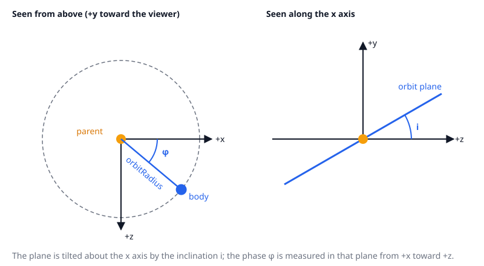

# Orbits

A body that orbits its parent carries an `OrbitComponent` (Spatial module). `OrbitalSystem` (CelestialObjects module) sets it up, advances it, predicts from it and moves the bodies.

## The orbit model

A circular orbit in the parent's frame, with a constant angular speed:

| Field | Meaning |
|---|---|
| `orbitRadius` | Distance from the parent, in game units. A radius of 0 or less is not an orbit. |
| `phase` | Angle in radians from the parent's +x axis toward +z. |
| `angularSpeed` | Radians per second; the phase advances by `angularSpeed * dt`. |
| `inclination` | Tilt of the orbit plane about the x axis, in radians. |

The offset from the parent is `r · (cos φ, sin φ · sin i, sin φ · cos i)`, so the plane's z is scaled by `cos i` and lifted by `sin i`.

The component computes it for any time: `offsetAt(t)` and `relativeVelocityAt(t)` take `t` in seconds from now (negative for the past), assuming the orbit keeps its speed. The component holds no reference to its parent.

The formula lives in `Shared/Helpers/OrbitMath.lua` (`offsetAt` and `velocityAt`, taking the radius, phase, angular speed, inclination and time), and the component calls it. Code that has no entities, such as the [system planner](system-planner.md) and the sandbox's circling obstacles, calls it too.

## Setting up

`collectOrbiters(root)` walks the hierarchy from `root`, parents before children, and for every body with an orbit sets:

- the phase from the body's current position relative to its parent, so that the orbit continues from where the generator placed the body and the first update doesn't jump;
- the angular speed `0.5 / sqrt(radius)`. This is a reduced Kepler-like rule, so that the travel drive can catch planets;
- the inclination from the body's `InclinationComponent`, which is in degrees.

It also returns the followers: rings and belts that have a parent but no orbit.

Predictions need this set-up. Bodies that were not set up are taken as not moving.

## Predicting

- `predictPos(entity, t)`: the body's parent's predicted position plus its own offset, through the `Core.Parent` chain. A body without an orbit stays where it is.
- `velocity(entity, t)`: the parent's velocity plus the body's velocity relative to it, so a moon's velocity includes its planet's. Zero for a body without an orbit.

Both read the orbit data, never the parent's rigid body. A rigid body moved with a kinematic target (below) reaches its position only when the physics step runs, so reading it would trail by a frame.

## Moving the bodies

`update(orbiters, dt, followers)` advances every phase, then moves each body to `predictPos(body, 0)`, so a child moves with the position its parent has this frame. It moves the body's rigid body with a kinematic target (spinning planets and moons on their axis, with the rotation period in hours), and sets its transform. A follower is put on its parent's predicted position.

The rigid body moves over the next physics step, so the app calls `update` and then steps the physics world with the same `dt`. Physics then sees each body's velocity: contacts push dynamic bodies, and `RigidBody:getVelocity()` reports the motion (the average over the last step, which differs from `velocity(entity, 0)` by a part of the order of `(angularSpeed · dt)²`). See [Physics](../engine/physics.md#kinematic-bodies).

Code that tracks a moving body (the autopilot's lead prediction) reads the body's velocity from its rigid body.
