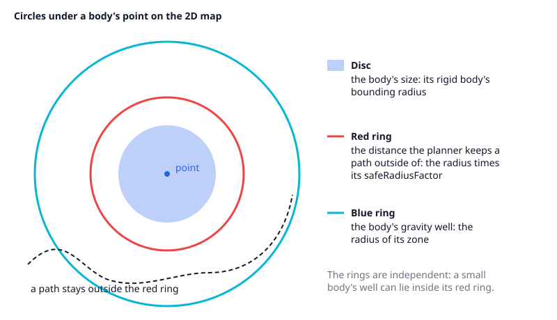
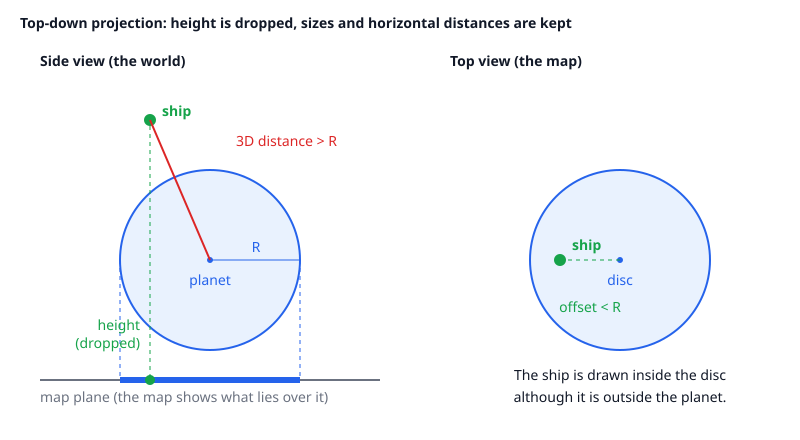

# System maps

`SystemMap` is the top-down 2D map of the star system and `SystemMap3D` the 3D one (both in the CelestialObjects module). The autopilot's route is drawn on both by `RouteOverlayRenderSystem` (UI module), through a world-to-screen mapping that each map supplies, so the two maps and the flight view draw it the same way.

## The route

`RouteOverlayRenderSystem:draw(overlay, toScreen, ctx)` takes an overlay table (`shipPos`, `targetPos`, `route`, `flown`, `progress`, `planning`) and draws:

- the target, the next waypoint, and the distance and ETA;
- the legs the ship has left to fly (`overlay.route`, from `Nav.route`), in white;
- the legs it has already passed (`overlay.flown`, from `Nav.routeFlown`), in a dimmer blue-grey, ending at the ship.

The passed legs are those of the current plan, so they start again when a new plan is made ([navigation orders](nav/navigation.md#queue-and-status)).

## Circles on the 2D map

Each body the system planner knows (star, planets, moons and stations, [system planner](nav/system-planner.md)) gets three circles under its point:

- **Disc**: the body's size, the bounding radius of its rigid body. It is the same radius the renderer and the planner use.
- **Red ring**: the distance the planner keeps a path outside of, `PlannerSnapshot.safeRadius`: the radius times `Config.game.autoPilot.safeRadiusFactor` for the body's kind. This is why a path goes around a body at some distance.
- **Blue ring**: the body's gravity well, the radius of its zone ([zones](zones.md)).

The rings are independent of one another, so a ring can lie inside another (a moon's well may be inside its red ring). A legend at the bottom left of the map names them.

A circle smaller than 2 px is not drawn, and a moon whose orbit is smaller than 20 px on screen is hidden with its circles. A circle whose quad would be more than four screens wide is not drawn; when the disc covers the whole map area, the area is filled instead, so a body does not vanish when the view is inside it.

## The map is a projection

The 2D map is an orthographic top-down view: world `x` and `z` give the screen position, and the height `y` is dropped. A disc is the body projected on the map plane, at the same scale as the distances. The ship is projected the same way.

A ship above or below a body is therefore drawn over its disc while it is outside the body. The planar offset on the map is at most the 3D distance, and the two agree only when the ship is in the plane of the body. The map's selected-body panel gives the 3D distance (`Distance`) and the radius (`Radius`): when the distance is larger than the radius for a ship that the map shows inside the disc, the ship is above or below the body. `SystemMap3D` shows the real separation.
