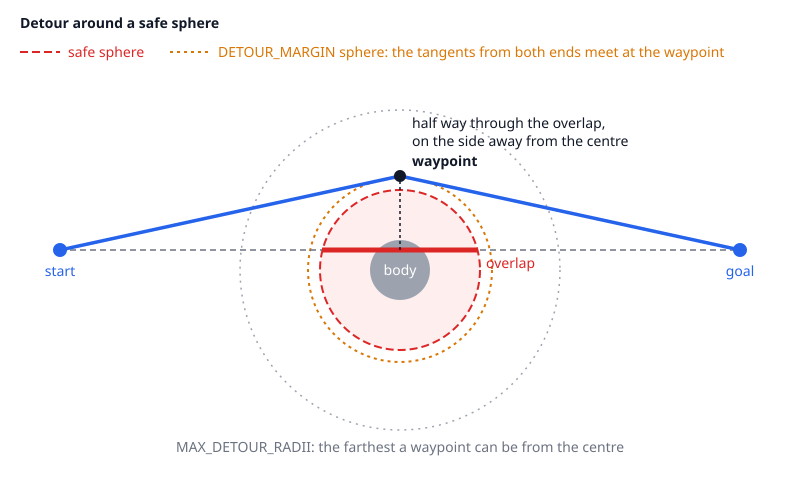
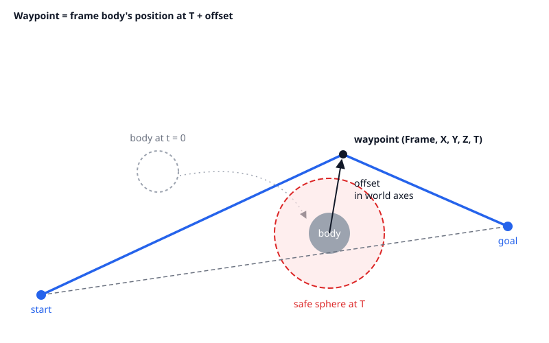

# System planner

`Shared/Helpers/SystemPlanner.lua` plans a path through a system of orbiting bodies as a list of waypoints. It is a pure Lua kernel: numbers in buffers go in, numbers come out, and it touches no entities and no globals, so it runs on a worker (see [Lua workers](workers.md)) or in a Lua test state. Its tests run it through the Lua kernel harness of the `nav` crate (`engine/lib/nav/tests/system_planner.rs`).

It plans in the frame of the system: bodies on analytic orbits are placed where they will be when the ship gets there, not where they are now.

## Input

`SystemPlanner.plan(bodies, count, sx, sy, sz, frame, gx, gy, gz, speed, depthLimit, out, capacity)` returns `status, waypointCount`. Positions are in game units, times in seconds from the snapshot, and `speed` is the speed the path is flown at (above zero), which sets the times in the output.

`frame` is the index of the body the goal rides on, or `SystemPlanner.SYSTEM_FRAME` (`-1`) for a goal fixed in the system. `g` is then the goal itself, or its offset from that body's centre, in world axes (see [Frames](#frames)).

`bodies` is a `double[?]` of `count * BODY_STRIDE` values; the offsets of a body's fields are `SystemPlanner.Body`:

| Field | Meaning |
|---|---|
| `Parent` | Index of the parent body, `-1` for none. A parent comes before its children |
| `X`, `Y`, `Z` | The position of a body that does not orbit; for a body that orbits, the position it circles when it has no parent |
| `OrbitRadius` | Orbit radius; zero or less means the body stays where it is |
| `Phase`, `AngularSpeed`, `Inclination` | The orbit at the snapshot, as in [orbits](orbits.md) |
| `Radius` | The hull's radius, above zero |
| `SafeRadius` | The radius the path keeps out of, at least `Radius` |

The position of a body at time `t` is its parent's position at `t` (its own fields without a parent) plus `OrbitMath.offsetAt` of its orbit, the formula that `OrbitComponent` uses too.

`out` is a `double[?]` of `capacity * OUT_STRIDE` values, the goal last; the offsets of a waypoint's fields are `SystemPlanner.Out`:

| Field | Meaning |
|---|---|
| `Frame` | Index of the body the offset is from, `SYSTEM_FRAME` for the system |
| `X`, `Y`, `Z` | The offset from that body's centre, in world axes; the point itself for the system frame |
| `T` | The time the ship reaches the waypoint when it flies the path at `speed` |

## Status

| Status | Meaning | Waypoints |
|---|---|---|
| `Ok` | Every leg clears every safe sphere at the times it passes | The plan |
| `DepthExceeded` | A leg still crosses a safe sphere at the depth limit; it is left straight | A plan with that leg |
| `NoDetour` | A leg crosses a safe sphere and no tangent exists; it is left straight | A plan with that leg |
| `CapacityExceeded` | The output buffer is full | The waypoints written before the stop |
| `GoalNotSettled` | The arrival time at a goal on a moving body did not settle (see [Frames](#frames)) | The last plan, whose times can be off |
| `EndpointInsideBody` | The start or the goal is inside a body's hull | None |
| `GoalOutrun` | The goal's frame body can move as fast as the ship, so the ship may never catch the goal | None |
| `InvalidInput` | A layout or number is wrong (a parent after its child, a radius not above zero, a safe radius below the radius, a non-finite value, a speed not above zero, a frame that is neither a body nor `SYSTEM_FRAME`) | None |

A status other than `Ok` is never hidden: the caller decides whether a plan with a straight leg is usable.

## Algorithm

1. **Endpoints.** A body whose safe sphere holds the start (at time zero) or the goal (at the time the ship gets there) has its safe radius cut to just under that distance for this plan, but not below its hull. Without this, a ship that starts or ends near a body could never leave or reach the point. An endpoint inside a hull is an error.
2. **Hit test.** The straight leg is walked in time. For each body, the next sample is the smallest time in which the ship and the body, at their fastest, could close the gap to the safe sphere, so the search cannot step over a crossing. A step has a minimum, a fraction of the radius (`GRAZE_STEP`), which ends a search that grazes the sphere, so a crossing shallower than that fraction can be missed. The first body hit along the leg is handled.
3. **Detour.** The waypoint is placed in the plane of the leg and the body's centre, half way through the overlap, on the side of the leg away from the centre. It is where the tangents from both ends to a sphere a little larger than the safe sphere (`DETOUR_MARGIN`) meet. When they meet farther than `MAX_DETOUR_RADII` radii from the centre, or not at all, the waypoint is put on the perpendicular at that cap. A body that crosses the leg faster than a fraction of the planning speed (`CROSSING_SPEED_FRACTION`) is passed on the side it is moving away from, so the waypoint is not where the body is heading.
4. **Recursion.** Both new legs are tested again, with their new times, down to `depthLimit`. A detour that fails further down (its waypoint lies inside another body, or a leg cannot be cleared) is redone on the other side of the body; if both sides fail, the first side's result stands and the status says why.

## Frames

A waypoint is a body and an offset from its centre, in world axes, not a fixed point: the bodies move while the ship flies, so a point fixed in the world would be where the body was when the plan was made. The offset does not turn with the body.

- **A detour waypoint** is in the frame of the body it goes around. Its offset is the planned point minus the body's position at the time `T` the ship reaches the waypoint, so a ship on schedule flies the path that was tested, and a late ship that resolves the offset against the body where it is then still keeps its distance from it.
- **The goal** keeps the caller's offset exactly. Where it is depends on when the ship gets there, and when the ship gets there depends on where it is, so the planner plans for the time the last plan arrives and repeats, until two arrival times differ by at most `GOAL_TIME_TOLERANCE` or `MAX_GOAL_ITERATIONS` passes are made. Each pass changes the arrival time by at most the ratio of the frame body's greatest speed (its own orbit and its parents') to the planning speed, so the repetition settles when that ratio is below one; a body that can move as fast as the ship is `GoalOutrun`. Where a detour appears or disappears as the goal's time changes, the arrival time jumps and has no fixed point: the status is `GoalNotSettled` and the last plan is kept, with waypoints that are valid in their frames and times that are off.
- **The system frame** (`SYSTEM_FRAME`) writes the point itself as the offset, the same output as a plan of fixed points.

The planner does not move the ship: whoever flies the plan resolves each waypoint with the frame body's position now, every frame, and a goal that rides on a body is flown with the body's velocity (see [navigation sandbox](navigation-sandbox.md)).

## Limits

- The planning speed is constant: the ship's acceleration and turns are not in the times. A ship that accelerates from rest arrives later than the plan says, so a body that was predicted to be clear can be in the way.
- A fast body that crosses the course can leave `NoDetour` or `DepthExceeded`.
- The retry on the other side makes a failing plan cost up to about 3^depth leg tests, and a goal on a moving body repeats the plan up to `MAX_GOAL_ITERATIONS` times; keep the depth limit small.
- The kernel keeps module scratch state, so it is not reentrant: one plan at a time per Lua state.

## Tuning

| Constant | Effect |
|---|---|
| `GRAZE_STEP` | Smallest hit-test step as a fraction of the safe radius: smaller finds shallower crossings and costs more samples |
| `OVERLAP_STEP` | Step through an overlap, as a fraction of the safe radius |
| `DETOUR_MARGIN` | How much larger than the safe sphere the detour goes around |
| `MAX_DETOUR_RADII` | How far from the centre a detour point can be, in detour radii |
| `CROSSING_SPEED_FRACTION` | Fraction of the planning speed above which a body counts as crossing the leg |
| `ENDPOINT_SHRINK` | How far below its distance a body's safe radius is cut for an endpoint |
| `GOAL_TIME_TOLERANCE` | How close two arrival times at a goal on a moving body must be to count as settled, in seconds; it is above the jitter of a detour point's time, which keeps a plan from looking unsettled |
| `MAX_GOAL_ITERATIONS` | How many passes the arrival time of a goal on a moving body is repeated for |

The safe radius itself comes from the caller; the sandbox uses a factor on the hull radius, `safeRadiusFactor` (see [navigation sandbox](navigation-sandbox.md)).
