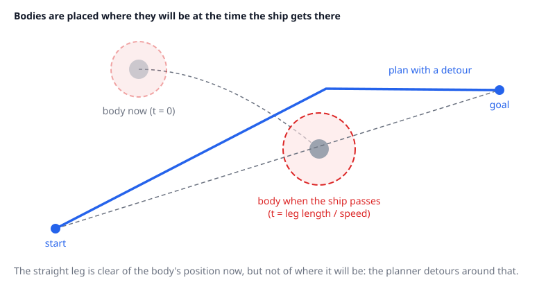
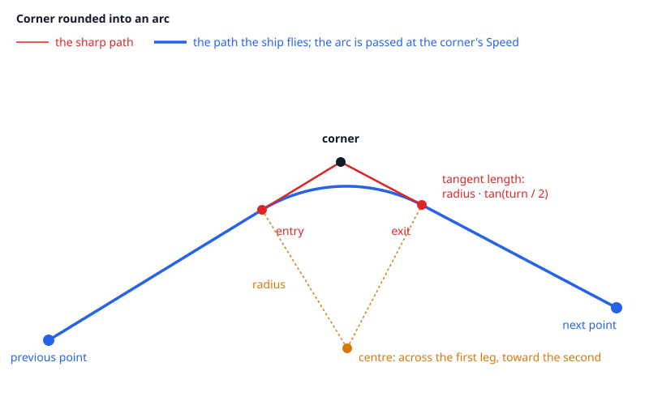
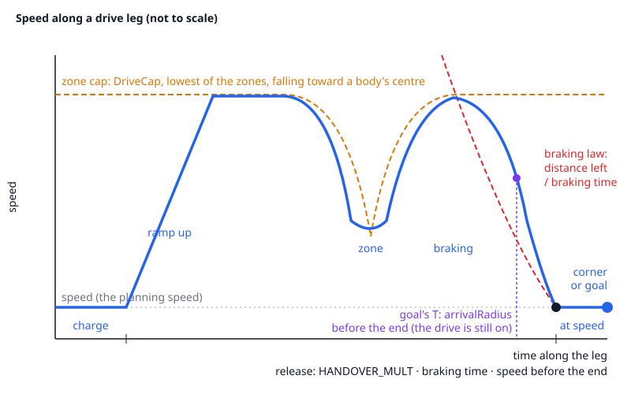
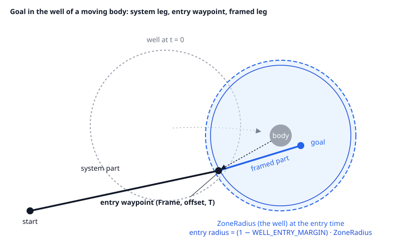

# System planner

`Shared/Helpers/SystemPlanner.lua` plans a path through a system of orbiting bodies as a list of waypoints. It is a pure Lua kernel: numbers in buffers go in, numbers come out, and it touches no entities and no globals, so it runs on a worker (see [Lua workers](workers.md)) or in a Lua test state. Its tests run it through the Lua kernel harness of the `nav` crate (`engine/lib/nav/tests/system_planner.rs`).

It plans in the frame of the system: bodies on analytic orbits are placed where they will be when the ship gets there, not where they are now.

## Input

`SystemPlanner.plan(bodies, count, sx, sy, sz, frame, gx, gy, gz, speed, accel, drag, depthLimit, out, capacity, drive)` returns `status, waypointCount`. Positions are in game units, times in seconds from the snapshot, and `speed` is the speed the path is flown at (above zero), which sets the times in the output. `accel` is the ship's forward acceleration (game units per second squared, above zero) and `drag` its linear drag (per second, zero or more): they set how fast the ship can take a corner (see [Corners](#corners)). `drive` is optional: a `double[?]` of `DRIVE_STRIDE` values that turns on the travel drive (see [Drive](#drive)); without it every leg is flown at `speed`.

`frame` is the index of the body the goal rides on, or `SystemPlanner.SYSTEM_FRAME` (`-1`) for a goal fixed in the system. `g` is then the goal itself, or its offset from that body's centre, in world axes (see [Frames](#frames)).

`bodies` is a `double[?]` of `count * BODY_STRIDE` values; the offsets of a body's fields are `SystemPlanner.Body`:

| Field | Meaning |
|---|---|
| `Parent` | Index of the parent body, `-1` for none. A parent comes before its children |
| `X`, `Y`, `Z` | The position of a body that does not orbit; for a body that orbits, the position it circles when it has no parent |
| `OrbitRadius` | Orbit radius; zero or less means the body stays where it is |
| `Phase`, `AngularSpeed`, `Inclination` | The orbit at the snapshot, as in [orbits](orbits.md) |
| `Radius` | The hull's radius, above zero |
| `SafeRadius` | The radius the path keeps out of, at least `Radius` |
| `ZoneRadius` | The radius of the body's travel-drive zone (see [Drive](#drive)); zero for no zone |
| `ZoneCap` | The drive multiplier at the body's centre, at least 1 when the body has a zone |

The position of a body at time `t` is its parent's position at `t` (its own fields without a parent) plus `OrbitMath.offsetAt` of its orbit, the formula that `OrbitComponent` uses too.

`out` is a `double[?]` of `capacity * OUT_STRIDE` values, the goal last; the offsets of a waypoint's fields are `SystemPlanner.Out`:

| Field | Meaning |
|---|---|
| `Frame` | Index of the body the offset is from, `SYSTEM_FRAME` for the system |
| `X`, `Y`, `Z` | The offset from that body's centre, in world axes; the point itself for the system frame |
| `T` | The time the ship reaches the waypoint when it flies the path at `speed` |
| `Radius` | The radius of the arc that rounds the corner at the waypoint; zero for a sharp corner, and for the goal |
| `Speed` | The speed the corner is passed at: the arc's turn speed, `speed` for a corner that barely turns; zero for a sharp corner and for the goal, where the ship stops |
| `Drive` | 1 when the leg that ends at the waypoint is flown under the travel drive, else 0 |

## Status

| Status | Meaning | Waypoints |
|---|---|---|
| `Ok` | Every leg clears every safe sphere at the times it passes | The plan |
| `DepthExceeded` | A leg still crosses a safe sphere at the depth limit; it is left straight | A plan with that leg |
| `NoDetour` | A leg crosses a safe sphere and no tangent exists; it is left straight | A plan with that leg |
| `CapacityExceeded` | The output buffer is full | The waypoints written before the stop |
| `GoalNotSettled` | The arrival time at a goal on a moving body did not settle (see [Frames](#frames)) | The last plan, whose times can be off |
| `DriveNotTimed` | A leg needed more drive timeline steps than `MAX_DRIVE_STEPS`; it is planned at the planning speed | A plan with that leg |
| `EndpointInsideBody` | The start or the goal is inside a body's hull | None |
| `GoalOutrun` | The goal's frame body can move as fast as the ship before the ship reaches the body's well, so the ship may never catch the goal (see [Frames](#frames)) | None |
| `InvalidInput` | A layout or number is wrong (a parent after its child, a radius not above zero, a safe radius below the radius, a non-finite value, a speed not above zero, a frame that is neither a body nor `SYSTEM_FRAME`, a zone with a negative radius or a cap below 1, a drive block with a cap below 1, a negative charge time, a rate not above zero, or a ship without drag) | None |

A status other than `Ok` is never hidden: the caller decides whether a plan with a straight leg is usable.

## Algorithm

1. **Endpoints.** A body whose safe sphere holds the start (at time zero) or the goal (at the time the ship gets there) has its safe radius cut to just under that distance for this plan, but not below its hull. Without this, a ship that starts or ends near a body could never leave or reach the point. An endpoint inside a hull is an error.
2. **Hit test.** The straight leg is walked in time. For each body, the next sample is the smallest time in which the ship and the body, at their fastest, could close the gap to the safe sphere, so the search cannot step over a crossing. A step has a minimum, a fraction of the radius (`GRAZE_STEP`), which ends a search that grazes the sphere, so a crossing shallower than that fraction can be missed. The first body hit along the leg is handled.
3. **Detour.** The waypoint is placed in the plane of the leg and the body's centre, half way through the overlap, on the side of the leg away from the centre. It is where the tangents from both ends to a sphere a little larger than the safe sphere (`DETOUR_MARGIN`) meet. When they meet farther than `MAX_DETOUR_RADII` radii from the centre, or not at all, the waypoint is put on the perpendicular at that cap. A body that crosses the leg faster than a fraction of the planning speed (`CROSSING_SPEED_FRACTION`) is passed on the side it is moving away from, so the waypoint is not where the body is heading.
4. **Recursion.** Both new legs are tested again, with their new times, down to `depthLimit`. A detour that fails further down (its waypoint lies inside another body, or a leg cannot be cleared) is redone on the other side of the body; if both sides fail, the first side's result stands and the status says why.

## Corners

Once the plan has settled, every corner but the goal is rounded into an arc that is tangent to both legs and has a speed the ship can hold it at. This runs for every status that keeps a plan, on the world points of the waypoints at their times.

1. **Radius.** The radius is the smaller of two limits.
   - The leg fit: the tangent length `R · tan(turn / 2)` is at most `ARC_LEG_SHARE` of each adjacent leg, so the arcs of neighbouring corners never overlap.
   - The knee: the radius at which the turn speed reaches `TURN_SPEED_KNEE` of its limit `TURN_THRUST_SHARE · accel / drag`. A larger arc buys little speed and costs path length, and without it arcs would grow to tens of kilometres on long legs. A ship without drag has no knee.
2. **Clearance.** The arc is checked against the bodies as `ARC_CHORDS` chords flown at the planning speed, the same way a leg is. A blocked arc is made half as large, up to `MAX_ARC_HALVINGS` times. If it is still blocked, the corner is left sharp: radius zero, speed zero, so the ship stops there. The chords lie between the arc and its centre, which is the side of the body the corner goes around, so a body there is found a little early; a body outside the arc can be missed by up to the chords' sagitta.
3. **Speed.** The speed is the positive root of `s⁴/r² + k²s² = (TURN_THRUST_SHARE · accel)²`, at most the planning speed: the speed at which the share of the forward thrust holds a circle of radius `r` against drag `k` and the centripetal demand. It is the formula of `nav::circle_speed` (the engine's orbit speed), and a test holds the kernel to it.
4. **Straight corners.** A turn below `MIN_ARC_ANGLE` gets no arc and the planning speed.

`SystemPlanner.cornerArc` gives the arc's entry, exit, centre and normal for a corner and a radius, and `SystemPlanner.pointOnArc` a point on it. They are the only copy of this geometry: whoever flies the plan builds the same arc from the corner's points as they are now.

## Drive

With a drive block, a leg is timed as the travel drive flies it, because the drive's speed changes by orders of magnitude along a leg and the plan's times decide where the moving bodies are predicted. A leg flown at the planning speed would put its detours where the bodies are long gone.

`drive` holds, at the offsets of `SystemPlanner.Drive`:

| Field | Meaning |
|---|---|
| `OpenCap` | The drive multiplier in open space, at least 1 |
| `Charge` | Seconds the drive charges, flown at `speed`; zero or more |
| `RampUp` | The multiplier rises by `(target − 1) · RampUp` per second |
| `RampDown` | The rate of the exponential with which the multiplier falls to a lower target |
| `MinLength` | The shortest leg flown under the drive, in game units; zero or more |

1. **Model.** A leg is a chain of time samples from the start of the leg. The ship flies at `speed` while the drive charges. After that the drive's target multiplier is the lowest of the zones' cap at the ship's point and time, `OpenCap`, and the braking law's multiplier for the distance left (`TravelDriveMath.brakingMultiplier`), and at least 1. The multiplier rises and falls toward it as in the table, and the ship's speed follows `speed ·` the multiplier with its drag, the lag of the real ship.
2. **Zones.** A body's zone caps the drive with `TravelDriveMath.zoneCap`, the formula `GravityWellSystem:getMaxDriveSpeedAt` uses too (see [zones](zones.md)); the zone is where its body is at the time. The braking law, the release distance and the ETA come from the same module, which the autopilot uses (`TravelDriveMath.travelTime`).
3. **Release.** The drive is released `HANDOVER_MULT · braking time · speed` before the leg's end, and the rest of the leg is flown at `speed`. So a drive leg ends below the multiplier at which the autopilot hands over, and never carries speed into a corner or the goal.
4. **Policy.** A leg is flown under the drive when its drive timeline ends sooner than flight at `speed`; a leg too short to charge and release is not, and neither is a leg shorter than `MinLength` (such a leg raises no `DriveNotTimed`). Every leg is judged on its own, so a detour splits a drive leg into two, each with its own charge, and the drive is released before every corner. Arcs are flown at the planning speed, at their turn speed, as without the drive.
5. **Steps.** A sample step is at most `DRIVE_FEATURE_STEP` of the distance to the nearest zone's edge (counted with the body's speed bound) and of the distance left, and, while the multiplier or the speed is off its target by more than `DRIVE_TRANSIENT_TOLERANCE`, at most `DRIVE_TRANSIENT_STEP` of the shortest time constant. A long cruise therefore costs few steps. A leg that needs more than `MAX_DRIVE_STEPS` is planned at `speed`, with the status `DriveNotTimed`.
6. **Hit tests.** The hit search and the overlap walk read the ship's distance along the leg from the timeline: each step is bounded by the greatest speed of its interval of samples, so no crossing is skipped, and an overlap that the ship leaves and re-enters is followed to its last time.

`Out.Drive` tells whoever flies the plan which legs to fly under the drive. A corner's arc may begin up to half a leg before its corner, so a ship that follows the plan releases the drive against the arc's entry, not the corner.

## Frames

A waypoint is a body and an offset from its centre, in world axes, not a fixed point: the bodies move while the ship flies, so a point fixed in the world would be where the body was when the plan was made. The offset does not turn with the body.

- **A detour waypoint** is in the frame of the body it goes around. Its offset is the planned point minus the body's position at the time `T` the ship reaches the waypoint, so a ship on schedule flies the path that was tested, and a late ship that resolves the offset against the body where it is then still keeps its distance from it.
- **The goal** keeps the caller's offset exactly. Where it is depends on when the ship gets there, and when the ship gets there depends on where it is, so the planner plans for the time the last plan arrives and repeats, until two arrival times differ by at most `GOAL_TIME_TOLERANCE` or `MAX_GOAL_ITERATIONS` passes are made. Each pass changes the arrival time by at most the ratio of the frame body's greatest speed (its own orbit and its parents') to the planning speed, so the repetition settles when that ratio is below one. Where a detour appears or disappears as the goal's time changes, the arrival time jumps and has no fixed point: the status is `GoalNotSettled` and the last plan is kept, with waypoints that are valid in their frames and times that are off.
- **The goal body's well** carries the ship. A ship inside a body's gravity well moves with the body (see [zones](zones.md)), so inside that well the body's own speed does not matter. The planner takes the well to be the body's `ZoneRadius`, and applies it when the goal's offset is inside the *entry radius*, `(1 − WELL_ENTRY_MARGIN)` of that radius (which must be larger than the body's safe radius; a goal farther out, or on a body without a zone, is planned as above). There are three modes:
  - *No well:* the plan is one system-frame plan, as above.
  - *Start inside the well:* the whole plan is flown in the body's frame. A leg is a straight line in offsets from the body, tested against the other bodies as they move relative to it, and a detour inside it is a waypoint in the frame of the body it goes around, as always. The body's speed is not used.
  - *Start outside the well:* the plan has a system part up to an **entry waypoint** on the entry sphere, and a part in the body's frame from there to the goal. The entry waypoint is in the goal body's frame, at the point where the straight line from the start to the goal first crosses the entry sphere at the *entry time*. The repetition above settles on the entry time (and the arrival time) together.
  
  The corner at the entry is not rounded: it has radius zero and the planning speed, like a straight corner. On entering, the ship keeps its own velocity relative to the well, so its velocity in the system changes by the body's, and the turn that makes is the flyer's to handle. Corners inside the framed part are rounded in the body's frame.
- **Outrun.** Only the part before the well counts. `GoalOutrun` is returned at once when the body's greatest speed is at least the top speed of that part: `speed` times the drive's `OpenCap` with a drive and a well to enter, else `speed`. A goal in a well that the ship starts in is never outrun. If the repetition has not settled and the chord from the start to the entry is no more than the body's greatest speed times the entry time, the ship cannot close on the entry and the status is `GoalOutrun`; otherwise it is `GoalNotSettled`. The drive's top speed is the bound because the planner can still time the part before the well under the drive; a leg shorter than `MinLength` is not.
- **The system frame** (`SYSTEM_FRAME`) writes the point itself as the offset, the same output as a plan of fixed points.

The planner does not move the ship: whoever flies the plan resolves each waypoint with the frame body's position now, every frame, and a goal that rides on a body is flown with the body's velocity (see [navigation sandbox](navigation-sandbox.md)).

## Limits

- The planning speed is constant: the ship's acceleration and turns are not in the times. A ship that accelerates from rest arrives later than the plan says, so a body that was predicted to be clear can be in the way.
- Arcs do not change the times: the planned path is still the sharp-cornered one, and a ship that slows to a corner's speed arrives later than `T` says. The arc's clearance is checked at the sharp path's times for the same reason.
- A corner is passed at its turn speed only if the ship can get down to it: the ship brakes toward the corner's speed before the arc, and how well it does is the flyer's, not the planner's.
- A drive leg's times follow the model above: the ship's charge, climb and lag are as the model has them, not as a flight measured them. A leg's start speed is taken as `speed`, though a ship that leaves an arc is slower.
- The carry is modelled in the goal body's well only. A detour through another body's well, and the nested wells of a goal on a moon or a station (the moon's well sits inside its planet's), are timed in the system frame, so the planner is conservative there: a body that outruns the ship before the goal body's well is `GoalOutrun`, though the ship might be carried by a larger well on the way.
- A goal exactly on a body's safe sphere (a stand-off distance equal to the safe radius) counts as inside it, within `ENDPOINT_TOUCH`, so that the rounding of positions does not turn a leg that ends there into a crossing.
- A fast body that crosses the course can leave `NoDetour` or `DepthExceeded`.
- `PlanFollower` builds a corner's arc from the corner's and its neighbours' world points, each as the frame body's position gives it for the planned time. That is the arc the planner cleared for a corner in the system frame; for a corner in the framed part of a plan into a well (a detour inside the well), the neighbours' points are at different times, and the arc is not checked to match the planner's frame-relative one.
- The retry on the other side makes a failing plan cost up to about 3^depth leg tests, and a goal on a moving body repeats the plan up to `MAX_GOAL_ITERATIONS` times; keep the depth limit small.
- The kernel keeps module scratch state, so it is not reentrant: one plan at a time per Lua state.

## Tuning

| Constant | Effect |
|---|---|
| `GRAZE_STEP` | Smallest hit-test step as a fraction of the safe radius: smaller finds shallower crossings and costs more samples |
| `OVERLAP_STEP` | Step through an overlap, as a fraction of the safe radius |
| `DETOUR_MARGIN` | How much larger than the safe sphere the detour goes around |
| `MAX_DETOUR_RADII` | How far from the centre a detour point can be, in detour radii |
| `CROSSING_SPEED_FRACTION` | Fraction of the planning speed above which a body counts as crossing the leg |
| `ENDPOINT_SHRINK` | How far below its distance a body's safe radius is cut for an endpoint |
| `ENDPOINT_TOUCH` | How far outside a safe sphere, as a fraction of its radius, a point still counts as on it: above the rounding of the positions it is measured from, far below any real gap |
| `WELL_ENTRY_MARGIN` | How far inside the goal body's well the entry waypoint lies, as a share of the well's radius: a ship that arrives a little off the entry is still inside the well that carries it; larger shortens the framed part |
| `GOAL_TIME_TOLERANCE` | How close two arrival times at a goal on a moving body must be to count as settled, in seconds; it is above the jitter of a detour point's time, which keeps a plan from looking unsettled |
| `MAX_GOAL_ITERATIONS` | How many passes the arrival time of a goal on a moving body is repeated for |
| `TURN_THRUST_SHARE` | The share of the forward thrust a turn may use: larger arcs are passed faster and leave less thrust for the velocity loop's lag and for avoidance |
| `TURN_SPEED_KNEE` | The fraction of the turn speed's limit at which an arc stops growing |
| `ARC_LEG_SHARE` | The most of an adjacent leg an arc's tangent may take |
| `ARC_CHORDS` | How many chords an arc is checked as |
| `MAX_ARC_HALVINGS` | How many times a blocked arc is halved before the corner is left sharp |
| `MIN_ARC_ANGLE` | The turn below which a corner gets no arc, in radians |
| `DRIVE_FEATURE_STEP` | The share of the distance to the nearest zone edge (and of the distance left) one drive timeline step covers: smaller times a zone more exactly and costs more steps |
| `DRIVE_FEATURE_FLOOR` | The least distance to a zone's edge that counts, as a share of its influence radius, so a ship on the edge still takes steps |
| `DRIVE_TRANSIENT_TOLERANCE`, `DRIVE_TRANSIENT_STEP` | How far the multiplier or speed may be off its target before steps shrink, and the share of the shortest time constant they shrink to |
| `DRIVE_MIN_STEP_S`, `MAX_DRIVE_STEPS` | The shortest step, and the most steps of one leg before it is planned without the drive |

The safe radius itself comes from the caller: the sandbox uses a factor on the hull radius, `safeRadiusFactor` (see [navigation sandbox](navigation-sandbox.md)), and the game takes one per body kind from `Config.game.autoPilot.safeRadiusFactor`.

## Consumers

The shared pieces in `Shared/Helpers`: `PlanClient` (a request to the planner's worker, polled once a frame), `SystemPlannerWorker` (the worker's script), `PlannerSnapshot` (the game's stars, planets, moons and stations as bodies, with the frames that place waypoints as they move on) and `PlanFollower` (flies a plan's corners and arcs). The navigation sandbox and the autopilot both use them.

The autopilot (`Modules/Constructs/Systems/AutoPilotPlan.lua`, see [flight](flight.md)) requests a plan when it engages. It flies straight to the goal in normal flight while the plan is out, then the corners of the plan, then the final approach with its own stand-off steering. A plan with status `Ok`, `GoalNotSettled` or `DriveNotTimed` is flown; any other status (a goal body that outruns the ship before its well, `GoalOutrun`, is the common one; a planet's well carries the ship, so a goal in a planet's well is planned) flies straight to the goal with the final approach's steering and drive law, with no detours. A corner is reached within the distance the ship covers at its top speed in `PASS_TIME_S`, which keeps the ship on the arc's circle. The entry waypoint of a plan into a goal body's well is a sharp corner like any other: it lies `WELL_ENTRY_MARGIN` of the well's radius inside the well, so the well carries the ship before it reaches the entry, and the entry waypoint, which moves with the body, is then at rest relative to the ship's frame. The drive's cap in that zone and its braking law bring the ship to the corner at the corner's speed. The drive is engaged at the start of a drive leg, capped by the braking law for the distance to the leg's end, and released below the hand-over multiplier; it is off on every arc.
